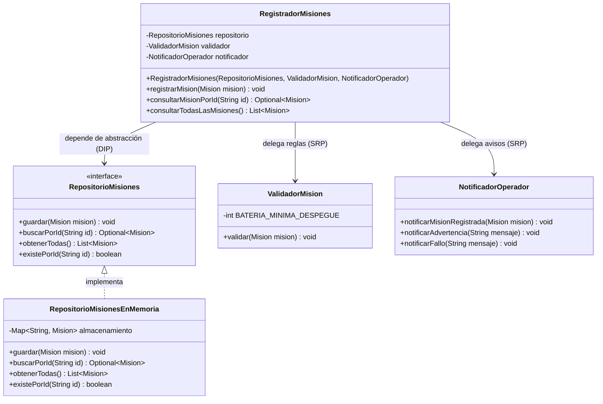
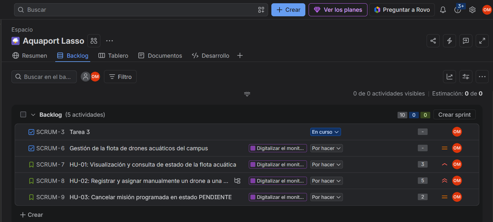
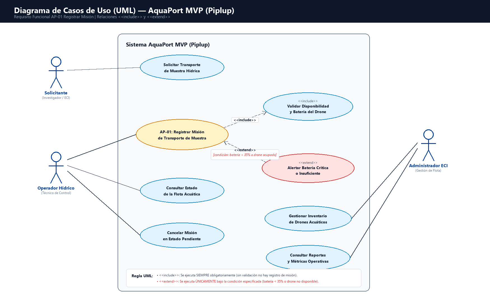

# 💧 Piplup — AquaPort MVP: Reparto Básico en el Campus

Sistema de drones acuáticos autónomos de la **Escuela Colombiana de Ingeniería Julio Garavito (ECI)** para transporte de muestras y sensores entre zonas hídricas.

---

## 📌 Contexto del Dominio
- **Flota actual:** 4 drones acuáticos modelo `Aqua-Ranger 100`.
- **Carga:** Muestras de agua, sensores ligeros y paquetes de reactivos.
- **Zonas:** Embalse Norte, Canal Central, Laguna Sur, Punto Ribereño Este y Laboratorio Hídrico.

---

## 🚀 Reto 01 — Streams & Lambdas

Implementación del servicio `ConsultorFlota` que responde a las necesidades operativas de la estación mediante **Java Streams** puros, eliminando por completo bucles iterativos y estados mutables.

### 📐 Flota Base de Prueba

```java
List<DroneAcuatico> flota = List.of(
    new DroneAcuatico("AR-01", "Aqua-Ranger 100", 92, true,  "Embalse Norte"),
    new DroneAcuatico("AR-02", "Aqua-Ranger 100", 45, true,  "Canal Central"),
    new DroneAcuatico("AR-03", "Aqua-Ranger 100", 18, false, "Laguna Sur"),
    new DroneAcuatico("AR-04", "Aqua-Ranger 100", 73, true,  "Punto Ribereño Este")
);
```

### 🔍 Explicación Visual de los 5 Streams

#### 1. Drones disponibles con batería ≥ 35% ordenados descendentemente
**Firma:** `List<DroneAcuatico> obtenerDronesDisponiblesConBateriaSuficiente(List<DroneAcuatico> flota)`
```text
  flota (List<DroneAcuatico>)
    │
    ├──> stream()
    ├──> filter(DroneAcuatico::disponible)                [Descarta AR-03 (no disponible)]
    ├──> filter(d -> d.bateria() >= 35)                   [Mantiene AR-01, AR-04, AR-02]
    ├──> sorted(Comparator.comparingInt(...).reversed())  [Ordena: 92% -> 73% -> 45%]
    └──> toList()                                         [Retorna lista inmutable]
```

#### 2. Solo IDs de drones disponibles
**Firma:** `List<String> obtenerIdsDronesDisponibles(List<DroneAcuatico> flota)`
```text
  flota (List<DroneAcuatico>)
    │
    ├──> stream()
    ├──> filter(DroneAcuatico::disponible)                [Mantiene AR-01, AR-02, AR-04]
    ├──> map(DroneAcuatico::id)                           [Transforma objeto -> String "AR-XX"]
    └──> toList()                                         [Retorna: ["AR-01", "AR-02", "AR-04"]]
```

#### 3. Existencia de drone disponible con batería ≥ 35%
**Firma:** `boolean existeDroneDisponibleConBateriaSuficiente(List<DroneAcuatico> flota)`
```text
  flota (List<DroneAcuatico>)
    │
    ├──> stream()
    └──> anyMatch(d -> d.disponible() && d.bateria() >= 35) [Short-circuit: retorna true en AR-01]
```

#### 4. Conteo de drones disponibles
**Firma:** `long contarDronesDisponibles(List<DroneAcuatico> flota)`
```text
  flota (List<DroneAcuatico>)
    │
    ├──> stream()
    ├──> filter(DroneAcuatico::disponible)                [Filtra elementos activos]
    └──> count()                                          [Retorna: 3L]
```

#### 5. Drone con mayor nivel de batería
**Firma:** `Optional<DroneAcuatico> obtenerDroneConMayorBateria(List<DroneAcuatico> flota)`
```text
  flota (List<DroneAcuatico>)
    │
    ├──> stream()
    └──> max(Comparator.comparingInt(DroneAcuatico::bateria)) [Retorna Optional con AR-01 (92%)]
```

---

## 🛠 Reto 03 — Patrón Creacional Builder (`Mision.Builder`)

Resuelve el problema de constructores telescópicos con múltiples parámetros ambiguos, garantizando **inmutabilidad** y **validación estricta en el método `build()`**.

```java
Mision mision = new Mision.Builder()
    .id("M-001")
    .drone(droneDisponible)
    .puntoPartida("Embalse Norte")
    .puntoLlegada("Laboratorio Hídrico")
    .tipoCarga(TipoCarga.MUESTRA_AGUA)
    .estado(EstadoMision.PENDIENTE)
    .build(); // Lanza IllegalStateException si algún campo es inválido o el drone no está disponible
```

---

## 🏛 Reto Arquitectura — Principios SRP y DIP en el Núcleo

### 1. Principio de Responsabilidad Única (SRP)
En lugar de un `GestorMision` monolítico con múltiples motivos para cambiar, el sistema separa las responsabilidades en componentes especializados:

* **`RegistradorMisiones`**: Orquesta el registro y las consultas de misiones.
* **`ValidadorMision`**: Encargado exclusivamente de las políticas y reglas de negocio operativas.
* **`NotificadorOperador`**: Encargado exclusivamente de emitir mensajes, alertas y reportes al operador.

### 2. Principio de Inversión de Dependencias (DIP)
`RegistradorMisiones` no se acopla a ningún almacenamiento concreto (como `BaseDatosLocal` o mapas en memoria directos). Depende de la interfaz abstracta:

```java
public interface RepositorioMisiones {
    void guardar(Mision mision);
    Optional<Mision> buscarPorId(String id);
    List<Mision> obtenerTodas();
    boolean existePorId(String id);
}
```

La implementación concreta (`RepositorioMisionesEnMemoria`) se suministra mediante **Constructor Injection**:

```java
RepositorioMisiones repo = new RepositorioMisionesEnMemoria();
ValidadorMision validador = new ValidadorMision();
NotificadorOperador notificador = new NotificadorOperador();

RegistradorMisiones registrador = new RegistradorMisiones(repo, validador, notificador);
```

### 3. Diagrama de Clases (UML)



---

## 📋 Requisitos y Priorización MoSCoW (Reto Requisitos)

| ID | Tipo | Descripción | MoSCoW | Justificación (1 oración) |
|---|---|---|---|---|
| **RF-01** | Funcional | Consulta de drones disponibles con batería $\ge 35\%$ | **Must Have** | Es imprescindible para que el operador conozca qué unidades pueden despegar antes de cualquier misión. |
| **RF-02** | Funcional | Registro y asignación manual de misión validada | **Must Have** | Es la funcionalidad central que justifica la existencia del sistema de transporte en el campus. |
| **RF-03** | Funcional | Filtrado de drones por zona hídrica | **Should Have** | Optimiza la toma de decisiones al priorizar drones cercanos, aunque la operación básica puede subsistir sin él. |
| **RNF-01** | No Funcional | Tiempo de respuesta en consulta $\le 200\text{ ms}$ | **Must Have** | Garantiza la fluidez requerida para que el operador atienda solicitudes sin bloqueos perceptibles en consola. |
| **RNF-02** | No Funcional | $100\%$ de validación de integridad inmutable al construir | **Must Have** | Impide que se inicien misiones con datos incompletos o drones inactivos que pongan en riesgo la carga. |
| **RNF-03** | No Funcional | Desacoplamiento de persistencia con pruebas $\le 1.5\text{ s}$ | **Should Have** | Facilita la evolución y mantenibilidad hacia persistencia externa en niveles futuros sin frenar el MVP. |

> Documento completo de especificación disponible en: [`docs/requisitos-moscow-piplup.md`](../docs/requisitos-moscow-piplup.md)

---

## 📑 Plantilla DOSW — Requisito AP-01

Especificación detallada bajo el estándar DOSW con tipos reales y sin elementos de UI:
* **Código:** `AP-01`
* **Nombre:** *Registrar misión de transporte de muestra*
* **Actor:** *Operador Hídrico*
* **Entradas:** `droneAsignado: DroneAcuatico(id, modelo, bateria, disponible, zona)`, `puntoPartida: String`, `puntoLlegada: String`, `tipoCarga: Enum(MUESTRA_AGUA, SENSOR, PAQUETE_LIGERO)`
* **Salidas:** `codigoMision: String`, `misionRegistrada: Mision(...)`
* **Flujos Alternos:** Drone con batería $< 35\%$ y zona de destino no autorizada / idéntica a partida.
* **Reglas de Negocio:** RN-01 (batería $\ge 35\%$ y sin misiones simultáneas) y RN-02 (coherencia de ruta entre zonas ECI).

> Plantilla completa disponible en: [`docs/plantilla-dosw-ap01.md`](../docs/plantilla-dosw-ap01.md)

---

## 🎨 Manual de Identidad Visual y UX/UI (Reto 08)

El sistema de diseño de AquaPort está optimizado para estaciones de monitoreo continuo en entornos hídricos:
* **Paleta:** Deep Abyssal Navy (`#0B132B`, fondo), Ocean Navy (`#1C2541`, cards), Bioluminescent Cyan (`#48CAE4`, acento primario).
* **Estados del Drone:** Disponible (`#10B981` verde), En Misión (`#3B82F6` azul), Recargando (`#F59E0B` ámbar), Batería Crítica/Fallo (`#EF4444` rojo), Mantenimiento (`#64748B` gris).
* **Tipografía:** `Inter` (UI general) y `JetBrains Mono` (IDs y telemetría).
* **Heurísticas de Nielsen Verificadas:**
  1. **#1 Visibilidad del estado:** Estado y batería identificables de un vistazo mediante colores y barras de progreso.
  2. **#3 Control del usuario:** Capacidad de cancelar asignaciones erróneas en estado `PENDIENTE`.
  3. **#5 Prevención de errores:** Deshabilitación visual proactiva de drones con batería $< 35\%$.
  4. **#8 Diseño minimalista:** Foco exclusivo en los 4 parámetros clave de decisión para el operador.
  5. **#9 Diagnóstico claro de errores:** Explicación técnica precisa de fallos con acciones de recuperación sugeridas.

> Manual de identidad, prompt de IA y evaluación detallada en: [`docs/manual-identidad-ux-nielsen.md`](../docs/manual-identidad-ux-nielsen.md)

---

## 🏃 Agilismo y Backlog en Jira (Reto 09)

Estructura jerárquica ágil configurada para el MVP:
* **Épica:** `Digitalizar el monitoreo y reparto hídrico de la ECI mediante una flota de drones acuáticos supervisada`
* **Feature:** `Gestión de la flota de drones acuáticos del campus`
* **Historias de Usuario:**
  * **HU-01:** *Como operador hídrico, quiero ver qué drones están disponibles y su nivel de batería para asignar la misión al drone más adecuado según la zona.*
  * **HU-02 (Focal):** *Como operador hídrico, quiero registrar y asignar manualmente un drone a una misión de transporte, para autorizar el despacho seguro de muestras ambientales.*
    * **Criterio 1:** Asignación exitosa con drone disponible y batería $\ge 35\%$.
    * **Criterio 2:** Bloqueo preventivo con `IllegalStateException` si batería $< 35\%$ o drone no disponible.
    * **Subtareas Técnicas:** Validación en `ValidadorMision`, construcción en `Mision.Builder`, persistencia y notificación en `RegistradorMisiones`.
  * **HU-03:** *Como operador hídrico, quiero cancelar una misión en estado PENDIENTE, para corregir asignaciones erróneas.*



> Especificación completa y guía de Jira en: [`docs/agilismo-jira-piplup.md`](../docs/agilismo-jira-piplup.md)

---

## 🎯 Diagrama de Casos de Uso UML (Reto 10)

Representación formal de las interacciones entre los 3 actores y los casos de uso del sistema centrados en el requisito **AP-01**:



### 📌 Distinción Clave: `<<include>>` vs. `<<extend>>`

* **`<<include>>` (Inclusión Obligatoria):**  
  * *Relación:* `AP-01: Registrar Misión` $\xrightarrow{<<include>>}$ `Validar Disponibilidad y Batería del Drone`.  
  * *Regla:* Se ejecuta **SIEMPRE** sin condición. El caso de uso base no puede completarse sin ejecutar previamente la validación.
* **`<<extend>>` (Extensión Condicional):**  
  * *Relación:* `Alertar Batería Crítica o Insuficiente` $\xrightarrow{<<extend>>}$ `AP-01: Registrar Misión`.  
  * *Regla y Condición:* Se ejecuta **ÚNICAMENTE bajo una condición específica** *(batería $< 35\%$ o drone no disponible)* para interceptar el flujo normal y prevenir el despacho de la misión.

> Archivo fuente PlantUML disponible en: [`docs/diagrama-cu-piplup.puml`](../docs/diagrama-cu-piplup.puml)

---

## 🖥️ Mocks de Interfaz con IA — 3 Estados del Panel (Reto 11)

Diseño de las pantallas del operador hídrico basado en la identidad visual de AquaPort y los datos de telemetría de los 4 drones del MVP:

### 1. Estado Normal (Flota Operativa Mixta)
*Visualización estándar con drones disponibles, en misión y en base de recarga:*  


### 2. Estado de Alerta (Drone en Estado FALLO Crítico)
*Detección de anomalía, banner superior y tarjeta destacada en rojo con acciones de rescate:*  


### 3. Estado Vacío (Toda la Flota en Misión)
*0 drones libres, bloqueo preventivo de asignaciones e indicador de próxima liberación:*  


### 🧭 Heurísticas de Nielsen Cumplidas
* **#1 Visibilidad del estado:** El operador distingue el estado de la flota en menos de 2 segundos.
* **#5 Prevención de errores:** Los drones sin carga o la falta de flota bloquean proactivamente los botones de acción (`disabled`).
* **#8 Minimalismo:** Enfoque exclusivo en ID, batería, estado y zona.
* **#9 Diagnóstico y recuperación de errores:** Mensajes explícitos y acciones de contingencia claras.

> Prompts completos y referencias industriales en: [`docs/mocks-ia-estados-panel.md`](../docs/mocks-ia-estados-panel.md)

---

## 💻 Compilación y Ejecución Manual

Desde la raíz del repositorio:

```powershell
javac -d bin Piplup/src/aquaport/model/*.java Piplup/src/aquaport/repository/*.java Piplup/src/aquaport/service/*.java Piplup/src/aquaport/*.java
java -cp bin aquaport.Main
```


