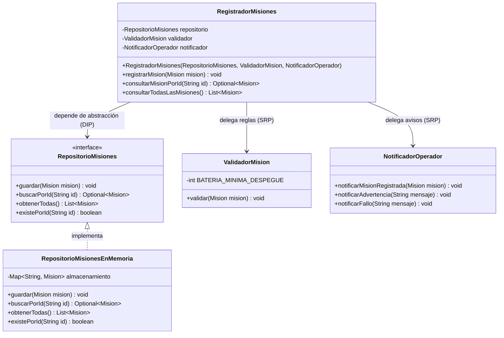

# 💧 Piplup — AquaPort MVP: Reparto Básico en el Campus

Sistema de drones acuáticos autónomos de la **Escuela Colombiana de Ingeniería Julio Garavito (ECI)** para transporte de muestras y sensores entre zonas hídricas.

---

## 📌 Contexto del Dominio
- **Flota actual:** 4 drones acuáticos modelo `Aqua-Ranger 100`.
- **Carga:** Muestras de agua, sensores ligeros y paquetes de reactivos.
- **Zonas:** Embalse Norte, Canal Central, Laguna Sur, Punto Ribereño Este y Laboratorio Hídrico.

---

## 🚀 Reto 01 — Streams & Lambdas

Implementación del servicio `ConsultorFlota` que responde a las necesidades operativas de la estación mediante **Java Streams** puros, eliminando por completo bucles iterativos y estados mutables.

### 📐 Flota Base de Prueba

```java
List<DroneAcuatico> flota = List.of(
    new DroneAcuatico("AR-01", "Aqua-Ranger 100", 92, true,  "Embalse Norte"),
    new DroneAcuatico("AR-02", "Aqua-Ranger 100", 45, true,  "Canal Central"),
    new DroneAcuatico("AR-03", "Aqua-Ranger 100", 18, false, "Laguna Sur"),
    new DroneAcuatico("AR-04", "Aqua-Ranger 100", 73, true,  "Punto Ribereño Este")
);
```

### 🔍 Explicación Visual de los 5 Streams

#### 1. Drones disponibles con batería ≥ 35% ordenados descendentemente
**Firma:** `List<DroneAcuatico> obtenerDronesDisponiblesConBateriaSuficiente(List<DroneAcuatico> flota)`
```text
  flota (List<DroneAcuatico>)
    │
    ├──> stream()
    ├──> filter(DroneAcuatico::disponible)                [Descarta AR-03 (no disponible)]
    ├──> filter(d -> d.bateria() >= 35)                   [Mantiene AR-01, AR-04, AR-02]
    ├──> sorted(Comparator.comparingInt(...).reversed())  [Ordena: 92% -> 73% -> 45%]
    └──> toList()                                         [Retorna lista inmutable]
```

#### 2. Solo IDs de drones disponibles
**Firma:** `List<String> obtenerIdsDronesDisponibles(List<DroneAcuatico> flota)`
```text
  flota (List<DroneAcuatico>)
    │
    ├──> stream()
    ├──> filter(DroneAcuatico::disponible)                [Mantiene AR-01, AR-02, AR-04]
    ├──> map(DroneAcuatico::id)                           [Transforma objeto -> String "AR-XX"]
    └──> toList()                                         [Retorna: ["AR-01", "AR-02", "AR-04"]]
```

#### 3. Existencia de drone disponible con batería ≥ 35%
**Firma:** `boolean existeDroneDisponibleConBateriaSuficiente(List<DroneAcuatico> flota)`
```text
  flota (List<DroneAcuatico>)
    │
    ├──> stream()
    └──> anyMatch(d -> d.disponible() && d.bateria() >= 35) [Short-circuit: retorna true en AR-01]
```

#### 4. Conteo de drones disponibles
**Firma:** `long contarDronesDisponibles(List<DroneAcuatico> flota)`
```text
  flota (List<DroneAcuatico>)
    │
    ├──> stream()
    ├──> filter(DroneAcuatico::disponible)                [Filtra elementos activos]
    └──> count()                                          [Retorna: 3L]
```

#### 5. Drone con mayor nivel de batería
**Firma:** `Optional<DroneAcuatico> obtenerDroneConMayorBateria(List<DroneAcuatico> flota)`
```text
  flota (List<DroneAcuatico>)
    │
    ├──> stream()
    └──> max(Comparator.comparingInt(DroneAcuatico::bateria)) [Retorna Optional con AR-01 (92%)]
```

---

## 🛠 Reto 03 — Patrón Creacional Builder (`Mision.Builder`)

Resuelve el problema de constructores telescópicos con múltiples parámetros ambiguos, garantizando **inmutabilidad** y **validación estricta en el método `build()`**.

```java
Mision mision = new Mision.Builder()
    .id("M-001")
    .drone(droneDisponible)
    .puntoPartida("Embalse Norte")
    .puntoLlegada("Laboratorio Hídrico")
    .tipoCarga(TipoCarga.MUESTRA_AGUA)
    .estado(EstadoMision.PENDIENTE)
    .build(); // Lanza IllegalStateException si algún campo es inválido o el drone no está disponible
```

---

## 🏛 Reto Arquitectura — Principios SRP y DIP en el Núcleo

### 1. Principio de Responsabilidad Única (SRP)
En lugar de un `GestorMision` monolítico con múltiples motivos para cambiar, el sistema separa las responsabilidades en componentes especializados:

* **`RegistradorMisiones`**: Orquesta el registro y las consultas de misiones.
* **`ValidadorMision`**: Encargado exclusivamente de las políticas y reglas de negocio operativas.
* **`NotificadorOperador`**: Encargado exclusivamente de emitir mensajes, alertas y reportes al operador.

### 2. Principio de Inversión de Dependencias (DIP)
`RegistradorMisiones` no se acopla a ningún almacenamiento concreto (como `BaseDatosLocal` o mapas en memoria directos). Depende de la interfaz abstracta:

```java
public interface RepositorioMisiones {
    void guardar(Mision mision);
    Optional<Mision> buscarPorId(String id);
    List<Mision> obtenerTodas();
    boolean existePorId(String id);
}
```

La implementación concreta (`RepositorioMisionesEnMemoria`) se suministra mediante **Constructor Injection**:

```java
RepositorioMisiones repo = new RepositorioMisionesEnMemoria();
ValidadorMision validador = new ValidadorMision();
NotificadorOperador notificador = new NotificadorOperador();

RegistradorMisiones registrador = new RegistradorMisiones(repo, validador, notificador);
```

### 3. Diagrama de Clases (UML)



---

## 💻 Compilación y Ejecución Manual

Desde la raíz del repositorio:

```powershell
javac -d bin Piplup/src/aquaport/model/*.java Piplup/src/aquaport/repository/*.java Piplup/src/aquaport/service/*.java Piplup/src/aquaport/*.java
java -cp bin aquaport.Main
```
