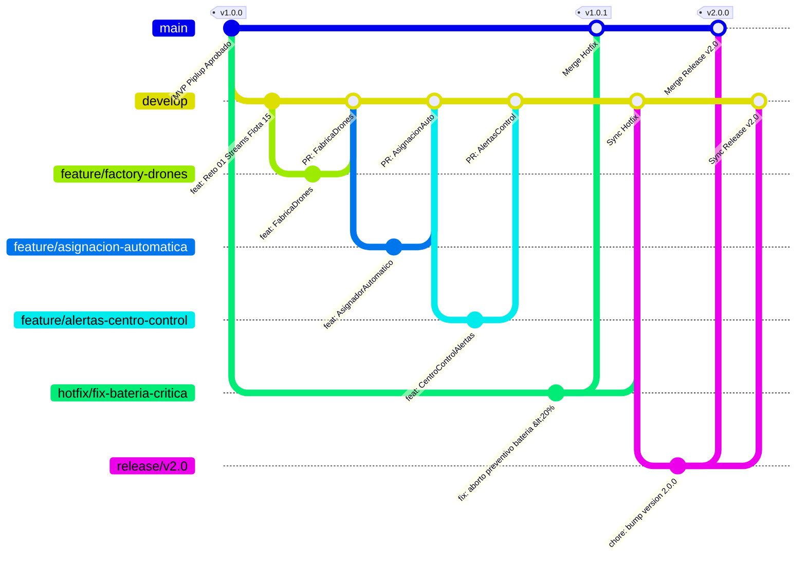
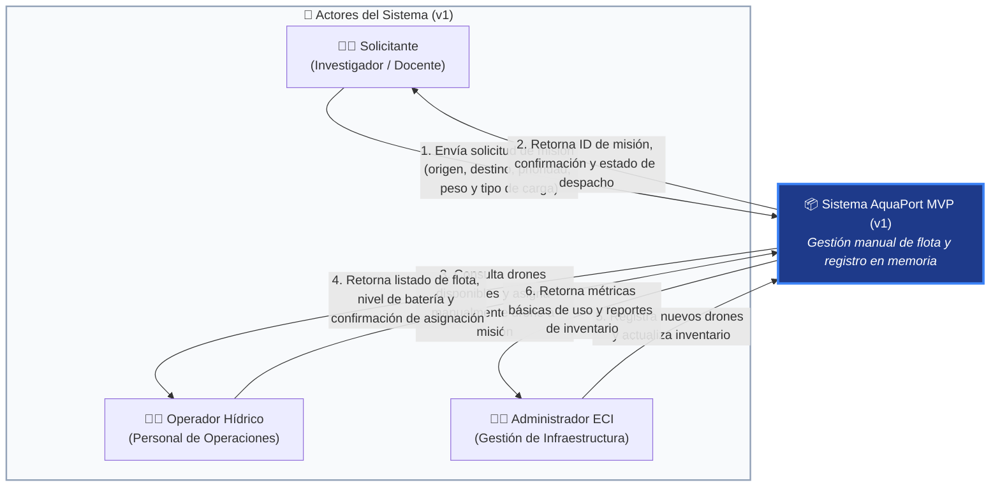
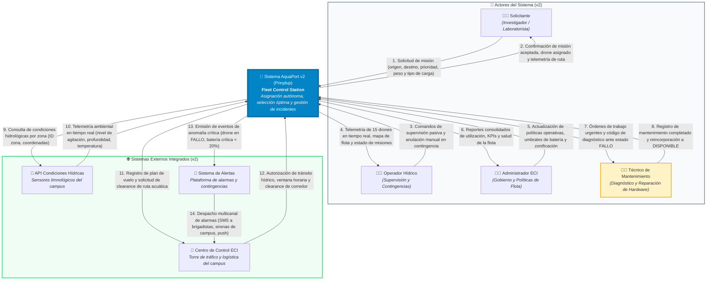

# 🐧 Prinplup — AquaPort v2: Flota Autónoma con Alertas

> **Nivel Intermedio de Evolución del Sistema AquaPort (ECI)**  
> 15 drones especializados de 3 tipos, asignación autónoma basada en condiciones hídricas, alertas de anomalías y precedencia absoluta de misiones críticas.  
> *En esta fase el sistema decide solo: el operador humano supervisa, no asigna.*

---

## 🌊 Contexto Operativo v2

La Escuela Colombiana de Ingeniería Julio Garavito (ECI) expande su infraestructura de monitoreo ambiental acuático a **15 drones** agrupados en tres categorías especializadas:

| Tipo de Drone | Entorno Operativo | Capacidad Máxima | Propósito Principal |
|---|---|---|---|
| 🚤 **Superficial** (`DroneSuperficial`) | Zonas tranquilas de embalses y lagunas | Hasta **500 g** (0.50 kg) | Transporte rápido de muestras superficiales y reactivos ligeros. |
| 🚢 **Semisumergido** (`DroneSemisumergido`) | Aguas agitadas, canales y corrientes moderadas | Hasta **1.50 kg** (1.50 kg) | Transporte de sensores hidrológicos pesados y navegación resiliente. |
| 🤿 **Buceador** (`DroneBuceador`) | Inmersión subacuática y aguas profundas | Hasta **300 g** (0.30 kg) | Extracción de muestras de sedimentos y parámetros en el fondo hídrico. |

### 🔄 Flujo Autónomo de Asignación v2

$$\text{Solicitud de Misión} \longrightarrow \text{Consulta Condiciones del Agua} \longrightarrow \text{Filtrado por Zona y Tipo} \longrightarrow \text{Estrategia de Selección Óptima} \longrightarrow \text{Validación} \longrightarrow \text{Asignación Automática} \longrightarrow \text{Alerta al Centro de Control}$$

---

## 🧩 Modelo de Dominio Ampliado

* **`EstadoDrone` (Enum):**  
  `DISPONIBLE`, `EN_MISION`, `RECARGANDO`, `MANTENIMIENTO`, `SUMERGIDO`.  
  *Contiene métodos utilitarios como `isDisponible()` y `isActivo()`.*
* **`Prioridad` (Enum):**  
  `CRITICA` *(Precedencia absoluta por contingencia o derrame)*, `ALTA`, `NORMAL`, `BAJA`.
* **`DroneAcuatico` (Clase Abstracta):**  
  Base polimórfica inmutable con atributos `id`, `modelo`, `bateria`, `estado`, `zona`, `capacidadCargaKg` y método abstracto `getTipo()`.
* **Subclases Especializadas:**  
  * [`DroneSuperficial`](file:///Prinplup/src/aquaport/model/DroneSuperficial.java)
  * [`DroneSemisumergido`](file:///Prinplup/src/aquaport/model/DroneSemisumergido.java)
  * [`DroneBuceador`](file:///Prinplup/src/aquaport/model/DroneBuceador.java)
* **`Mision`:**  
  Asocia ruta (`puntoPartida`, `puntoLlegada`), `prioridad`, `drone`, `tipoCarga` y `estado`.

---

## 🎯 Reto 01: Streams & Lambdas Avanzados en Flota de 15 Drones

Implementado en el servicio [`ConsultorFlotaAvanzado`](file:///Prinplup/src/aquaport/service/ConsultorFlotaAvanzado.java) bajo el paradigma de pipelines funcionales puros (sin bucles mutables ni efectos colaterales).

### 1️⃣ Agrupar drones disponibles por tipo de drone (`groupingBy`)
```java
Map<TipoDrone, List<DroneAcuatico>> disponiblesPorTipo = flota.stream()
        .filter(DroneAcuatico::isDisponible)
        .collect(Collectors.groupingBy(DroneAcuatico::getTipo));
```
* **Resultado:**  
  * **Superficial (2 disponibles):** `DS-01` (Bat: 95%), `DS-03` (Bat: 40%).  
  * **Semisumergido (3 disponibles):** `DM-01` (Bat: 88%), `DM-03` (Bat: 90%), `DM-04` (Bat: 55%).  
  * **Buceador (3 disponibles):** `DB-01` (Bat: 92%), `DB-03` (Bat: 65%), `DB-04` (Bat: 30%).

---

### 2️⃣ Obtener el drone óptimo para una zona dada (mayor batería, tipo compatible)
```java
Optional<DroneAcuatico> optimo = flota.stream()
        .filter(DroneAcuatico::isDisponible)
        .filter(drone -> zona.equalsIgnoreCase(drone.getZona()))
        .filter(drone -> drone.getTipo() == tipoCompatible)
        .max(Comparator.comparingInt(DroneAcuatico::getBateria));
```
* **Caso aplicado:** En `"Embalse Norte"` con requerimiento `SEMISUMERGIDO` $\longrightarrow$ Selecciona **`DM-03`** (Batería: 90%).

---

### 3️⃣ Calcular el promedio de batería por tipo de drone (`averagingDouble`)
```java
Map<TipoDrone, Double> promedios = flota.stream()
        .collect(Collectors.groupingBy(
                DroneAcuatico::getTipo,
                Collectors.averagingDouble(DroneAcuatico::getBateria)
        ));
```
* **Resultados en la flota de 15 drones:**  
  * 🚢 **Semisumergido:** `65.6%`  
  * 🤿 **Buceador:** `55.4%`  
  * 🚤 **Superficial:** `46.4%`

---

### 4️⃣ Separar misiones CRÍTICAS de las demás (`partitioningBy`)
```java
Map<Boolean, List<Mision>> particionadas = misiones.stream()
        .collect(Collectors.partitioningBy(
                mision -> mision.getPrioridad() == Prioridad.CRITICA
        ));
```
* **`true` (Misiones Críticas):**  
  * `MIS-202` (Embalse Norte $\rightarrow$ Bahía Ciencia, Drone `DM-03`).  
  * `MIS-204` (Bahía Ciencia $\rightarrow$ Laguna Sur, Drone `DB-01`).
* **`false` (Misiones Regulares / Otras Prioridades):**  
  * `MIS-201` (NORMAL), `MIS-203` (ALTA), `MIS-205` (BAJA).

---

### 5️⃣ Listar todas las zonas únicas que cubre la flota activa (`distinct`, `sorted`)
```java
List<String> zonas = flota.stream()
        .filter(DroneAcuatico::isActivo)
        .map(DroneAcuatico::getZona)
        .distinct()
        .sorted()
        .toList();
```
* **Zonas cubiertas:** `Bahía Ciencia`, `Canal Central`, `Dársena Oeste`, `Embalse Norte`, `Laboratorio Hídrico`, `Laguna Sur`, `Punto Ribereño Este`.

---

### ➕ Operación Complementaria: Cola de Misiones por Precedencia y Batería
```java
List<Mision> ordenadas = misiones.stream()
        .sorted(Comparator.comparing((Mision m) -> m.getPrioridad().getNivel())
                .thenComparing(m -> m.getDrone().getBateria(), Comparator.reverseOrder()))
        .toList();
```
*Garantiza que las misiones de mayor urgencia se despachen primero, y ante igual nivel de prioridad se favorezca el drone con mayor reserva energética.*

---

## 🌿 GitHub y GitFlow en AquaPort v2 (Reto 02)

Estrategia formal de ramas bajo el modelo **GitFlow** implementada para el ciclo de vida de la versión 2.0:



### 📋 Mapeo de Ramas y Responsabilidades en el Repositorio

| Rama | Tipo GitFlow | Origen | Destino | Propósito / Alcance | Enlace / PR en GitHub |
|---|---|---|---|---|---|
| **`main`** | Producción | — | — | Código estable aprobado en producción (`v1.0.0`, `v1.0.1`, `v2.0.0`). | [Rama `main`](https://github.com/Oscar10lm/MaterialRefuerzoPiplup/tree/main) |
| **`develop`** | Integración | `main` | `main` (vía release) | Integración continua de features completadas de la versión 2. | [Rama `develop`](https://github.com/Oscar10lm/MaterialRefuerzoPiplup/tree/develop) |
| **`feature/factory-drones`** | Feature | `develop` | `develop` | Implementación del patrón Factory Method ([`FabricaDrones`](file:///Prinplup/src/aquaport/service/FabricaDrones.java)) para creación de drones polimórficos. | [PR `feature/factory-drones`](https://github.com/Oscar10lm/MaterialRefuerzoPiplup/pull/new/feature/factory-drones) |
| **`feature/asignacion-automatica`** | Feature | `develop` | `develop` | Asignación inteligente y autónoma según agitación hídrica y carga ([`AsignadorAutomaticoMisiones`](file:///Prinplup/src/aquaport/service/AsignadorAutomaticoMisiones.java)). | [PR `feature/asignacion-automatica`](https://github.com/Oscar10lm/MaterialRefuerzoPiplup/pull/new/feature/asignacion-automatica) |
| **`feature/alertas-centro-control`** | Feature | `develop` | `develop` | Despacho y monitoreo automático de alertas ante batería crítica y fallos ([`CentroControlAlertas`](file:///Prinplup/src/aquaport/service/CentroControlAlertas.java)). | [PR `feature/alertas-centro-control`](https://github.com/Oscar10lm/MaterialRefuerzoPiplup/pull/new/feature/alertas-centro-control) |
| **`hotfix/fix-bateria-critica`** | Hotfix | `main` | `main` & `develop` | Parche urgente en caliente sobre producción: evaluación de batería crítica $< 20\%$ con aborto preventivo. | [PR `hotfix/fix-bateria-critica`](https://github.com/Oscar10lm/MaterialRefuerzoPiplup/pull/new/hotfix/fix-bateria-critica) |
| **`release/v2.0`** | Release | `develop` | `main` & `develop` | Estabilización, incremento de versión a `2.0.0` y verificación pre-despliegue. | [PR `release/v2.0`](https://github.com/Oscar10lm/MaterialRefuerzoPiplup/pull/new/release/v2.0) |

### 🏷️ Tags de Versión Oficiales

* **`v1.0.0`**: MVP AquaPort (Piplup) con 14 retos aprobados.
* **`v1.0.1`**: Hotfix urgente sobre producción para validación preventiva de batería crítica $< 20\%$.
* **`v2.0.0`**: AquaPort v2 (Prinplup) — Flota autónoma multimodal de 15 drones con asignación inteligente y alertas.

---

## 🏗️ Patrones de Diseño de la v2 (Reto 03)

La arquitectura de AquaPort v2 integra tres patrones fundamentales del GoF:

### 1. 🏭 Factory Method — ¿Cómo crear cada tipo de drone?
* **Componente:** [`FabricaDrones`](file:///Prinplup/src/aquaport/service/FabricaDrones.java).
* **Rol:** Encapsula la decisión de qué subclase polimórfica instanciar (`DroneSuperficial`, `DroneSemisumergido`, `DroneBuceador`) según el `TipoDrone` solicitado.
* **Ventaja:** Incorporar nuevos tipos de drones no requiere tocar la lógica del asignador ni del consultor de flota (principio OCP).

### 2. 🧭 Strategy — ¿Qué drone elegir?
* **Contrato:** [`EstrategiaSeleccionDrone`](file:///Prinplup/src/aquaport/service/strategy/EstrategiaSeleccionDrone.java).
* **Estrategias concretas:**
  * [`MayorBateriaStrategy`](file:///Prinplup/src/aquaport/service/strategy/MayorBateriaStrategy.java): Maximiza la reserva energética.
  * [`ZonaCercanaStrategy`](file:///Prinplup/src/aquaport/service/strategy/ZonaCercanaStrategy.java): Prioriza proximidad física para reducir traslados en vacío.
  * [`PrioridadCriticaStrategy`](file:///Prinplup/src/aquaport/service/strategy/PrioridadCriticaStrategy.java): Exige batería $\ge 50\%$ y favorece drones de máxima robustez.
* **Cero violaciones:** El [`AsignadorAutomaticoMisiones`](file:///Prinplup/src/aquaport/service/AsignadorAutomaticoMisiones.java) no contiene sentencias `instanceof`, delegando de forma 100% polimórfica en la estrategia activa.

### 3. 📢 Observer — ¿Quién se entera del fallo?
* **Contrato:** [`ObservadorFalloDrone`](file:///Prinplup/src/aquaport/service/observer/ObservadorFalloDrone.java).
* **Observadores concretos:**
  * [`CentroControlObserver`](file:///Prinplup/src/aquaport/service/observer/CentroControlObserver.java): Despacha alarmas de monitoreo y telemetría.
  * [`TecnicoMantenimientoObserver`](file:///Prinplup/src/aquaport/service/observer/TecnicoMantenimientoObserver.java): Genera órdenes de trabajo inmediatas para el equipo técnico.
* **Desacoplamiento:** Los observadores se suscriben o desuscriben dinámicamente (`agregarObservador`, `removerObservador`) sin tocar las clases de dominio.

### 🧪 Verificación con Mockito (Notificación Exactamente 1 Vez)
Prueba automatizada en [`PatronesDisenoIntegracionTest.java`](file:///Prinplup/test/aquaport/service/PatronesDisenoIntegracionTest.java):
```java
// Al registrar una misión con drone en estado FALLO:
assertThrows(IllegalStateException.class, () -> asignador.registrarMision(misionConFallo));

// Mockito verifica que cada observador registrado fue notificado exactamente 1 vez:
verify(mockCentroControl, times(1)).notificarFallo(eq(droneEnFallo), anyString());
verify(mockTecnicoMantenimiento, times(1)).notificarFallo(eq(droneEnFallo), anyString());
verifyNoMoreInteractions(mockCentroControl);
verifyNoMoreInteractions(mockTecnicoMantenimiento);
```

---

## 📐 Reto 04: Principios SOLID en AquaPort v2

En la arquitectura de **AquaPort v2 (Prinplup)**, cada componente y abstracción fue diseñado siguiendo rigurosamente los 5 principios SOLID para garantizar extensibilidad sin modificación, sustituibilidad polimórfica y bajo acoplamiento en un entorno crítico de monitoreo ambiental autónomo.

### 📋 Auditoría de Clases e Interfaces de la v2

| Clase / Interfaz | Paquete | Principio(s) Aplicado(s) | Cómo se Aplica en AquaPort v2 |
|---|---|---|---|
| [`DroneAcuatico`](file:///Prinplup/src/aquaport/model/DroneAcuatico.java) | `model` | **OCP, LSP** | Abstracción base inmutable que encapsula atributos universales de la flota y define el método template polimórfico `getTipo()`, extensible a nuevos tipos sin tocar el núcleo. |
| [`DroneSuperficial`](file:///Prinplup/src/aquaport/model/DroneSuperficial.java) | `model` | **SRP, LSP, OCP** | Especialización para aguas calmas con capacidad fija de 500 g. Sustituye limpiamente a `DroneAcuatico` sin romper contratos de validación ni lanzar excepciones imprevistas. |
| [`DroneSemisumergido`](file:///Prinplup/src/aquaport/model/DroneSemisumergido.java) | `model` | **SRP, LSP, OCP** | Especialización para aguas agitadas y corrientes con capacidad de 1.50 kg. Cumple todos los invariantes de batería y disponibilidad de la superclase. |
| [`DroneBuceador`](file:///Prinplup/src/aquaport/model/DroneBuceador.java) | `model` | **SRP, LSP, OCP** | Especialización subacuática con capacidad de 300 g para toma de muestras en profundidad. Sustituible en cualquier pipeline que consuma `DroneAcuatico`. |
| [`TipoDrone`](file:///Prinplup/src/aquaport/model/TipoDrone.java) | `model` | **SRP** | Encapsula exclusivamente la taxonomía categórica de drones admitidos por la plataforma. |
| [`CondicionAgua`](file:///Prinplup/src/aquaport/model/CondicionAgua.java) | `model` | **SRP** | Representa los estados físicos del cuerpo hídrico (`CALMA`, `AGITADA`, `PROFUNDA`) para evaluación desacoplada de aptitud. |
| [`Prioridad`](file:///Prinplup/src/aquaport/model/Prioridad.java) | `model` | **SRP** | Modela los niveles de urgencia (`CRITICA`, `ALTA`, `NORMAL`, `BAJA`) para guiar las políticas de asignación. |
| [`EstadoMision`](file:///Prinplup/src/aquaport/model/EstadoMision.java) | `model` | **SRP** | Modela el ciclo de vida de una orden de trabajo (`PLANIFICADA`, `EN_CURSO`, `COMPLETADA`, `CANCELADA`, `FALLIDA`). |
| [`Mision`](file:///Prinplup/src/aquaport/model/Mision.java) | `model` | **SRP** | Agrega los metadatos de la misión (ruta, prioridad, drone asignado, carga). Única razón de cambio: cambios en la especificación de una misión. |
| [`Alerta`](file:///Prinplup/src/aquaport/model/Alerta.java) | `model` | **SRP** | Encapsula el evento de notificación emitido por anomalías operativas o telemétricas. |
| [`NivelAlerta`](file:///Prinplup/src/aquaport/model/NivelAlerta.java) | `model` | **SRP** | Clasificación de severidad de eventos (`INFO`, `ADVERTENCIA`, `CRITICA`). |
| [`FabricaDrones`](file:///Prinplup/src/aquaport/service/FabricaDrones.java) | `service` | **SRP, OCP** | Centraliza la instanciación de drones según su `TipoDrone`. Aísla el código cliente de conocer los constructores concretos. |
| [`EstrategiaSeleccionDrone`](file:///Prinplup/src/aquaport/service/strategy/EstrategiaSeleccionDrone.java) | `service.strategy` | **OCP, ISP, DIP** | Interfaz delgada enfocada en un único propósito: seleccionar el drone óptimo entre un conjunto de candidatos. |
| [`MayorBateriaStrategy`](file:///Prinplup/src/aquaport/service/strategy/MayorBateriaStrategy.java) | `service.strategy` | **SRP, LSP, DIP** | Implementación concreta de selección por reserva energética máxima. |
| [`ZonaCercanaStrategy`](file:///Prinplup/src/aquaport/service/strategy/ZonaCercanaStrategy.java) | `service.strategy` | **SRP, LSP, DIP** | Implementación concreta de selección por proximidad geográfica para minimizar tránsito en vacío. |
| [`PrioridadCriticaStrategy`](file:///Prinplup/src/aquaport/service/strategy/PrioridadCriticaStrategy.java) | `service.strategy` | **SRP, LSP, DIP** | Implementación concreta de selección para contingencias con umbral de batería $\ge 50\%$. |
| [`ObservadorFalloDrone`](file:///Prinplup/src/aquaport/service/observer/ObservadorFalloDrone.java) | `service.observer` | **ISP, DIP, OCP** | Interfaz funcional segregada (`@FunctionalInterface`) con un único método (`notificarFallo`), evitando obligar a los clientes a implementar métodos irrelevantes. |
| [`CentroControlObserver`](file:///Prinplup/src/aquaport/service/observer/CentroControlObserver.java) | `service.observer` | **SRP, LSP, DIP** | Receptor de alarmas para la estación de control telemétrico. |
| [`TecnicoMantenimientoObserver`](file:///Prinplup/src/aquaport/service/observer/TecnicoMantenimientoObserver.java) | `service.observer` | **SRP, LSP, DIP** | Receptor de incidentes para emisión de órdenes de reparación y triaje. |
| [`AsignadorAutomaticoMisiones`](file:///Prinplup/src/aquaport/service/AsignadorAutomaticoMisiones.java) | `service` | **SRP, OCP, DIP** | Coordina la asignación inteligente y el despacho de fallos dependiendo exclusivamente de abstracciones (`EstrategiaSeleccionDrone`, `ObservadorFalloDrone`). |
| [`CentroControlAlertas`](file:///Prinplup/src/aquaport/service/CentroControlAlertas.java) | `service` | **SRP** | Gestiona el registro histórico y despacho de alertas del campus. |
| [`ConsultorFlotaAvanzado`](file:///Prinplup/src/aquaport/service/ConsultorFlotaAvanzado.java) | `service` | **SRP** | Servicio analítico que ejecuta consultas declarativas sobre la flota mediante Streams & Lambdas. |

---

### 🔍 Análisis Detallado de los 5 Principios SOLID

#### 1. S — Single Responsibility Principle (Principio de Responsabilidad Única)
* **Dónde se respeta:**
  * En [`FabricaDrones.java`](file:///Prinplup/src/aquaport/service/FabricaDrones.java): Su única responsabilidad es instanciar la subclase adecuada de `DroneAcuatico` según las especificaciones de fábrica. No realiza validaciones de misiones ni gestiona inventarios.
  * En [`AsignadorAutomaticoMisiones.java`](file:///Prinplup/src/aquaport/service/AsignadorAutomaticoMisiones.java): Su único rol es orquestar la asignación y coordinar el despacho de fallos. Delega la lógica de decisión a las estrategias y la reacción a los observadores.
  * En [`CentroControlAlertas.java`](file:///Prinplup/src/aquaport/service/CentroControlAlertas.java): Únicamente almacena y despacha alertas a los suscriptores telemétricos.
* **Por qué importa en AquaPort:**
  En una estación de monitoreo fluvial y lacustre con 15 drones autónomos, separar la toma de decisiones (asignación), la creación de unidades (fábrica), el reporte de incidentes (alertas) y las consultas analíticas evita que un cambio en la normativa de alarmas afecte los algoritmos de vuelo o el motor de despacho.

#### 2. O — Open/Closed Principle (Principio Abierto/Cerrado)
* **Dónde se respeta:**
  * **Jerarquía de Drones abierta a extensión:** Al incorporar un 4to tipo de drone (por ejemplo, `DroneSumergibleProfundo`), **no se modifica en lo absoluto ni una sola línea de [`AsignadorAutomaticoMisiones.java`](file:///Prinplup/src/aquaport/service/AsignadorAutomaticoMisiones.java)** ni del modelo base. El asignador interactúa puramente con la abstracción `DroneAcuatico` y sus métodos polimórficos (`getCapacidadCargaKg()`, `getTipo()`, etc.).
  * **Estrategias de Selección abiertas a extensión:** Al incorporar nuevas políticas operativas (como `ZonaCercanaStrategy`, `PrioridadCriticaStrategy` o una estrategia ad-hoc `PrimerDisponibleStrategy`), el asignador las consume a través del contrato [`EstrategiaSeleccionDrone`](file:///Prinplup/src/aquaport/service/strategy/EstrategiaSeleccionDrone.java) sin tocar su implementación ni recurrir a condicionales `if-else` o `switch`.
  * **Sistema de Alertas abierto a extensión:** Se pueden registrar nuevos escuchas (ej. guardacostas, servicios web externos) implementando [`ObservadorFalloDrone`](file:///Prinplup/src/aquaport/service/observer/ObservadorFalloDrone.java) sin alterar la lógica de despacho.
* **Por qué importa en AquaPort:**
  Permite desplegar nuevos prototipos de hardware acuático (drones de profundidad abisal o lanchas de rescate) y nuevas políticas de optimización de combustible/batería en caliente sin recompilar ni arriesgar regresiones en el núcleo de navegación autónoma.

#### 3. L — Liskov Substitution Principle (Principio de Sustitución de Liskov)
* **Dónde se respeta:**
  * En todas las subclases de [`DroneAcuatico`](file:///Prinplup/src/aquaport/model/DroneAcuatico.java): [`DroneSuperficial`](file:///Prinplup/src/aquaport/model/DroneSuperficial.java), [`DroneSemisumergido`](file:///Prinplup/src/aquaport/model/DroneSemisumergido.java), [`DroneBuceador`](file:///Prinplup/src/aquaport/model/DroneBuceador.java) y el nuevo `DroneSumergibleProfundo`.
  * **Cumplimiento estricto de invariantes y contratos:**
    1. Ninguna subclase lanza excepciones imprevistas en métodos de consulta (`getBateria()`, `getCapacidadCargaKg()`, `isDisponible()`, `toString()`).
    2. Ninguna subclase retorna `null` donde el contrato del padre espera un valor consistente o un `Optional`.
    3. Todas las subclases respetan las precondiciones (batería acotada entre $0$ y $100$, capacidades estrictamente positivas) y postcondiciones del padre.
    4. En [`SolidPrincipiosTest.java:L103-L125`](file:///Prinplup/test/aquaport/service/SolidPrincipiosTest.java#L103-L125), se demuestra cómo cualquier colección de `DroneAcuatico` heterogénea se procesa uniformemente sin requerir verificaciones de tipo (`instanceof`) ni casting explícito.
* **Por qué importa en AquaPort:**
  Si un `DroneBuceador` retornara `null` o lanzara `UnsupportedOperationException` al consultar su capacidad de carga o nivel de batería en un algoritmo de asignación masiva, causaría una falla catastrófica en tiempo de ejecución, cancelando operaciones de contención de vertimientos en el campus.

#### 4. I — Interface Segregation Principle (Principio de Segregación de Interfaces)
* **Dónde se respeta:**
  * En [`ObservadorFalloDrone.java`](file:///Prinplup/src/aquaport/service/observer/ObservadorFalloDrone.java): Define un único método enfocado:
    ```java
    @FunctionalInterface
    public interface ObservadorFalloDrone {
        void notificarFallo(DroneAcuatico drone, String motivo);
    }
    ```
    No obliga a [`CentroControlObserver`](file:///Prinplup/src/aquaport/service/observer/CentroControlObserver.java) ni a [`TecnicoMantenimientoObserver`](file:///Prinplup/src/aquaport/service/observer/TecnicoMantenimientoObserver.java) a implementar métodos innecesarios (como monitoreo de GPS en vivo, telemetría de turbinas o control de carga eléctrica).
  * En [`EstrategiaSeleccionDrone.java`](file:///Prinplup/src/aquaport/service/strategy/EstrategiaSeleccionDrone.java): Segregada exclusivamente a la selección (`seleccionar`) y nomenclatura (`getNombre`), sin forzar métodos de serialización o persistencia.
* **Por qué importa en AquaPort:**
  Los observadores técnicos de hardware no tienen por qué acoplarse a interfaces "gordas" que manejen reportes administrativos o facturación, permitiendo componentes ligeros y de bajo consumo de memoria.

#### 5. D — Dependency Inversion Principle (Principio de Inversión de Dependencias)
* **Dónde se respeta:**
  * En [`AsignadorAutomaticoMisiones.java`](file:///Prinplup/src/aquaport/service/AsignadorAutomaticoMisiones.java):
    * El asignador (módulo de alto nivel) **no depende de ninguna clase concreta** como `MayorBateriaStrategy` ni `CentroControlObserver`.
    * Depende exclusivamente de **abstracciones**: [`EstrategiaSeleccionDrone`](file:///Prinplup/src/aquaport/service/strategy/EstrategiaSeleccionDrone.java) y [`ObservadorFalloDrone`](file:///Prinplup/src/aquaport/service/observer/ObservadorFalloDrone.java).
    * La estrategia activa y los observadores se inyectan a través del constructor o mediante métodos mutadores (`setEstrategia`, `agregarObservador`):
      ```java
      public AsignadorAutomaticoMisiones(EstrategiaSeleccionDrone estrategia) {
          this.estrategia = Objects.requireNonNull(estrategia, "La estrategia no puede ser nula");
      }
      ```
* **Por qué importa en AquaPort:**
  Permite alternar dinámicamente entre políticas de selección (p. ej., conmutar a `PrioridadCriticaStrategy` cuando se activa un protocolo de emergencia ambiental) e inyectar *test doubles* (mocks de Mockito) en pruebas unitarias sin levantar infraestructura real de radiocomunicación.

---

### 🧪 Pruebas Automatizadas de Principios SOLID

El cumplimiento formal de los principios SOLID se verifica mediante la suite [`SolidPrincipiosTest.java`](file:///Prinplup/test/aquaport/service/SolidPrincipiosTest.java):

```java
@Test
@DisplayName("OCP: Se agrega el 4to tipo de drone (DroneSumergibleProfundo) sin modificar AsignadorAutomaticoMisiones")
void ocp_cuartoTipoDeDrone_funcionaSinModificarAsignador() {
    AsignadorAutomaticoMisiones asignador = new AsignadorAutomaticoMisiones(new MayorBateriaStrategy());
    DroneAcuatico nuevoDrone = new DroneSumergibleProfundo("DSP-01", "Abyssal Explorer 3000", 99, EstadoDrone.DISPONIBLE, ZonasCampus.BAHIA_CIENCIA);

    Optional<DroneAcuatico> seleccionado = asignador.seleccionarDroneOptimo(
            List.of(nuevoDrone), ZonasCampus.BAHIA_CIENCIA, CondicionAgua.PROFUNDA, 0.250
    );

    assertTrue(seleccionado.isPresent());
    assertEquals("DSP-01", seleccionado.get().getId());
}
```

---

## 🗺️ Reto 05: Diagrama de Contexto C4 (MVP v1 vs. v2 Prinplup)

El **Diagrama de Contexto (Nivel 1 del Modelo C4)** establece las fronteras de software de AquaPort, identificando las personas (actores) que interactúan con él y los sistemas externos con los que se comunica en la infraestructura del campus de la Escuela Colombiana de Ingeniería Julio Garavito (ECI).

> [!IMPORTANT]
> **Regla clave del diagrama:** Toda flecha entre el sistema, los actores y los sistemas externos está rigurosamente etiquetada indicando **QUÉ datos específicos fluyen** y en **QUÉ dirección**.

---

### 1. Diagrama de Contexto — AquaPort MVP (v1 - Piplup)

En la versión inicial (MVP), AquaPort operaba como un sistema autónomo cerrado y manual, enfocado en una flota de 4 drones sin integración con servicios externos.



---

### 2. Diagrama de Contexto — AquaPort v2 (Prinplup)

En la **v2 (Prinplup)**, el sistema evoluciona hacia una **estación de control autónoma** que interactúa con un nuevo actor especializado (**Técnico de Mantenimiento**) y **3 sistemas externos** en red para la toma de decisiones automatizada en tiempo real.



---

### 3. Matriz de Flujos de Datos Bidireccionales v2

| Origen | Destino | Datos que Fluyen | Propósito Operacional en AquaPort |
|---|---|---|---|
| **Solicitante** | **AquaPort v2** | `PuntoPartida`, `PuntoLlegada`, `Prioridad`, `TipoCarga`, `PesoKg` | Solicitar un transporte o muestreo limnológico. |
| **AquaPort v2** | **Solicitante** | `IdMision`, `EstadoMision`, `IdDroneAsignado`, `TiempoEstimado` | Confirmar y reportar el ciclo de vida de la misión. |
| **Operador Hídrico** | **AquaPort v2** | Comandos de control, pausas de emergencia, override manual | Mantener supervisión humana de alto nivel sin asignación rutinaria. |
| **AquaPort v2** | **Operador Hídrico** | Telemetría en vivo de 15 drones (batería, zona, estado, carga) | Monitoreo situacional del estado del campus en tiempo real. |
| **Administrador ECI** | **AquaPort v2** | Políticas de prioridad, umbrales de corte, zonas permitidas | Gobierno y parametrización de la plataforma. |
| **AquaPort v2** | **Administrador ECI** | Reportes de utilización, horas de operación, tasa de incidentes | Auditoría, planeación y sustentación de recursos. |
| **AquaPort v2** | **Técnico Mantenimiento** | `IdDrone`, `Zona`, `MotivoFallo`, `DiagnosticoPreliminar` | Despachar orden de servicio inmediata cuando un drone entra en `FALLO`. |
| **Técnico Mantenimiento** | **AquaPort v2** | Reporte de reparación, checklist técnico, cambio a `DISPONIBLE` | Devolver drones reparados al pool activo de asignación. |
| **AquaPort v2** | **API Condiciones Hídricas** | `IdZona`, `CoordenadasGPS`, `Timestamp` | Consultar la viabilidad hidrológica del cuerpo de agua antes de asignar. |
| **API Condiciones Hídricas** | **AquaPort v2** | `NivelAgitacion` (Calma/Agitada), `ProfundidadMetros`, `TemperaturaC` | Determinar si se requiere un `DroneSuperficial`, `Semisumergido` o `Buceador`. |
| **AquaPort v2** | **Centro de Control ECI** | `PlanDeVuelo`, `CorredorNavegacion`, `PrioridadMision` | Registrar la misión institucional y solicitar derecho de paso acuático. |
| **Centro de Control ECI** | **AquaPort v2** | `CodigoClearance`, `AprobacionRuta`, `VentanaHoraria` | Garantizar que no colisione con otras actividades náuticas o de mantenimiento. |
| **AquaPort v2** | **Sistema de Alertas** | `IdAlerta`, `NivelAlerta` (CRITICA), `DroneAfectado`, `ZonaIncidente` | Notificar incidentes severos en caliente (batería crítica, fallo de motor). |

---

### 4. Cuadro Comparativo: ¿Qué Creció? vs. ¿Qué se Mantuvo?

```
┌────────────────────────────────────────────────────────────────────────────────────────┐
│                        EVOLUCIÓN ARQUITECTÓNICA: MVP (v1) → v2                         │
├───────────────────────────────────────────┬────────────────────────────────────────────┤
│               🌱 QUÉ CRECIÓ               │              ⚓ QUÉ SE MANTUVO              │
├───────────────────────────────────────────┼────────────────────────────────────────────┤
│ • Nuevo Actor Especializado:              │ • Propósito Central del Negocio:           │
│   Incorporación del Técnico de Mantenimiento│   Monitoreo ambiental, recolección de      │
│   para el ciclo de vida de fallas físicas.│   muestras y transporte hídrico en campus. │
│                                           │                                            │
│ • 3 Nuevos Sistemas Externos:             │ • Actores Primarios Fundamentales:         │
│   - API Condiciones Hídricas (IoT en vivo)│   Solicitante, Operador Hídrico y          │
│   - Centro de Control ECI (Clearance institucional)│   Administrador ECI continúan activos.     │
│   - Sistema de Alertas (Notificación multicanal)│                                            │
│                                           │ • Reglas de Seguridad Inviolables:         │
│ • Cambio de Paradigma Operativo:          │   Reserva mínima de batería de despegue    │
│   De asignación manual por operador a     │   (≥ 35%), control estricto de carga útil   │
│   asignación autónoma algorítmica.        │   y validación previa de disponibilidad.   │
│                                           │                                            │
│ • Escala y Especialización de la Flota:   │ • Modelo de Dominio Nuclear:               │
│   De 4 drones genéricos a 15 drones       │   Conceptos de Misión, Ruta, Prioridad,    │
│   divididos en 3 subclases hidrológicas.  │   Zonas del campus y Estado del Drone.     │
└───────────────────────────────────────────┴────────────────────────────────────────────┘
```

#### 📊 Detalle Analítico de la Transición

1. **¿Qué creció?**
   * **El ecosistema de integración:** El sistema dejó de ser una aplicación aislada para convertirse en un nodo central de un ecosistema interconectado con sensores ambientales (API de condiciones hídricas), autoridad de tráfico (Centro de Control) y plataformas de respuesta a emergencias (Sistema de Alertas).
   * **El flujo de entrada de datos:** Ahora el sistema consume variables hidrológicas dinámicas (profundidad, agitación, corrientes) que condicionan la selección del hardware antes de despachar una misión.
   * **El canal de soporte técnico:** La incorporación del *Técnico de Mantenimiento* cierra la brecha entre el software y el hardware físico: las fallas no quedan como simples registros mudos, sino que generan órdenes de servicio operativas.

2. **¿Qué se mantuvo?**
   * **La esencia funcional:** Garantizar el transporte confiable de cargas científicas y toma de muestras a lo largo del sistema lagunar de la Escuela.
   * **El gobierno institucional:** El *Administrador ECI* mantiene el control sobre la flota y el *Operador Hídrico* conserva la potestad de veto e intervención humana en caso de emergencia.
   * **Los invariantes de seguridad:** La integridad física de los drones y la preservación del cuerpo de agua permanecen como la máxima prioridad inmutable del diseño.

---

## 📋 Reto 06: Especificación de Requisitos (RF/RNF), Priorización MoSCoW y Resolución de Tensión AP-07 vs AP-08

> 📄 *Documentación formal completa disponible en: [`docs/requisitos-moscow-prinplup.md`](file:///docs/requisitos-moscow-prinplup.md)*

### 1. Cuatro Nuevos Requisitos Funcionales (RF) — v2
* **RF-01 (Asignación Automática por Strategy):**  
  *Actor:* Sistema AquaPort / Solicitante.  
  *Acción:* Evalúa la flota de 15 drones y selecciona automáticamente la unidad óptima según la política activa ([`MayorBateriaStrategy`](file:///Prinplup/src/aquaport/service/strategy/MayorBateriaStrategy.java), [`ZonaCercanaStrategy`](file:///Prinplup/src/aquaport/service/strategy/ZonaCercanaStrategy.java) o [`PrioridadCriticaStrategy`](file:///Prinplup/src/aquaport/service/strategy/PrioridadCriticaStrategy.java)).  
  *Resultado Observable:* Drone reservado, misión en estado `PENDIENTE` y confirmación de plan de ruta.
* **RF-02 (Alertas de Fallo en Tiempo Real - Observer):**  
  *Actor:* Sistema AquaPort / Centro de Control / Técnico de Mantenimiento.  
  *Acción:* Al detectarse un drone en estado `FALLO` o batería crítica $< 20\%$, emite el evento síncrono a todos los observadores registrados.  
  *Resultado Observable:* Alerta severa en [`CentroControlObserver`](file:///Prinplup/src/aquaport/service/observer/CentroControlObserver.java) y orden técnica prioritaria con diagnóstico en [`TecnicoMantenimientoObserver`](file:///Prinplup/src/aquaport/service/observer/TecnicoMantenimientoObserver.java).
* **RF-03 (Consulta y Filtrado por Condiciones Hídricas):**  
  *Actor:* Sistema AquaPort (consumiendo la *API Condiciones Hídricas*).  
  *Acción:* Consulta las condiciones limnológicas (`CALMA`, `AGITADA`, `PROFUNDA`) antes de autorizar la misión.  
  *Resultado Observable:* Filtra y descarta drones incompatibles de casco/inmersión (solo `Superficial` en aguas calmas $\le 500\text{g}$, `Semisumergido` en aguas agitadas $\le 1.5\text{kg}$, y `Buceador` en profundidad $\le 300\text{g}$).
* **RF-04 (Gestión de Órdenes y Reintegración por Técnico):**  
  *Actor:* Técnico de Mantenimiento.  
  *Acción:* Consulta los diagnósticos de fallo, efectúa las reparaciones mecánicas/electrónicas y reporta la finalización en el sistema.  
  *Resultado Observable:* El drone transiciona a `DISPONIBLE`, restableciendo su elegibilidad para nuevas asignaciones autónomas.

---

### 2. Cuatro Requisitos No Funcionales (RNF) con Métrica Objetiva Concreta

> [!TIP]
> **Sin ambigüedades:** Todo RNF declara métrica cuantitativa, condición de carga y método/instrumento de verificación reproducible.

| ID | Requisito No Funcional | Métrica Objetiva Concreta | Método de Verificación |
|---|---|---|---|
| **RNF-01** | **Rendimiento de Asignación Automática** | Selección y asignación del drone óptimo en **$< 400\text{ ms}$** para una flota ampliada de hasta **30 drones** en memoria. | Test unitario con JUnit 5: `assertTimeout(Duration.ofMillis(400), ...)` en [`AsignadorAutomaticoMisionesTest`](file:///Prinplup/test/aquaport/service/AsignadorAutomaticoMisionesTest.java). |
| **RNF-02** | **Latencia de Despacho de Eventos (Observer)** | Tiempo total de notificación a observadores **$\le 50\text{ ms}$** con tasa de entrega del **$100\%$** (0 eventos perdidos). | Test de integración con Mockito: `verify(..., times(1)).notificarFallo(...)` y cronometrado en [`PatronesDisenoIntegracionTest`](file:///Prinplup/test/aquaport/service/PatronesDisenoIntegracionTest.java). |
| **RNF-03** | **Robustez e Invariantes de Seguridad (*Fail-Fast*)** | **$0$** asignaciones con batería $< 35\%$ ($< 50\%$ en críticas) o sobrepeso, con rechazo tipado en **$< 10\text{ ms}$**. | Aserciones negativas de JUnit 5: `assertThrows(IllegalStateException.class, ...)` en validadores y asignador. |
| **RNF-04** | **Extensibilidad Arquitectónica (OCP)** | **$0$ líneas modificadas** en [`AsignadorAutomaticoMisiones.java`](file:///Prinplup/src/aquaport/service/AsignadorAutomaticoMisiones.java) al agregar un 4to tipo de drone o nueva estrategia. | Prueba automatizada en [`SolidPrincipiosTest`](file:///Prinplup/test/aquaport/service/SolidPrincipiosTest.java) y verificación con `git diff`. |

---

### 3. Matriz de Priorización MoSCoW

| ID | Tipo | Prioridad | Justificación MoSCoW |
|---|---|---|---|
| **RF-01** | Funcional | **Must Have** | Capacidad nuclear que sustituye la asignación manual humana por decisiones algorítmicas autónomas. |
| **RF-02** | Funcional | **Must Have** | Crítico para evitar el extravío o hundimiento de drones ante fallas en los embalses. |
| **RF-03** | Funcional | **Must Have** | Previene volcamientos de drones ligeros en zonas de corriente y oleaje moderado. |
| **RF-04** | Funcional | **Should Have** | Necesario para la autosostenibilidad de la flota en el mediano plazo tras reparaciones. |
| **RNF-01** | No Funcional | **Must Have** | Respuestas sub-segundo garantizan que no haya bloqueos en despachos de emergencia. |
| **RNF-02** | No Funcional | **Must Have** | La cuadrilla técnica requiere enterarse de forma instantánea ante un fallo físico. |
| **RNF-03** | No Funcional | **Must Have** | La seguridad física de equipos y preservación del agua es la restricción máxima ineludible. |
| **RNF-04** | No Funcional | **Should Have** | Mantiene bajo costo de mantenimiento al expandir la flota institucional con nuevos modelos. |

---

### ⚡ 4. Detección y Resolución de la Tensión: AP-07 vs. AP-08

#### 🔍 La Tensión Detectada:
* **AP-07:** *El sistema asigna automáticamente el drone de mayor batería disponible para cualquier misión hídrica.*
* **AP-08:** *Las misiones CRÍTICAS tienen prioridad absoluta: deben recibir el drone técnicamente más apto para la zona, independientemente de la batería.*

**¿Por qué no son contradictorios?**  
Porque aplican bajo objetivos operacionales distintos: AP-07 rige misiones ordinarias para balancear el ciclo de vida de las celdas eléctricas; AP-08 rige contingencias ambientales donde lo que prima es la supervivencia de la misión y la adecuación estructural del casco.

**¿Dónde radica la tensión real?**  
Si coexisten en el mismo cuerpo de agua:
1. Un `DroneSuperficial` con **$95\%$ de batería** (máxima batería, pero frágil ante turbulencia).
2. Un `DroneSemisumergido` con **$88\%$ de batería** (especializado para corrientes y agitación).

Si se aplica ciegamente **AP-07**, se elegiría el Superficial de 95%, resultando en volcamiento. Si se aplica **AP-08** sin umbrales ("independientemente de la batería"), se podría despachar un Semisumergido con solo 5% de batería, apagándose en mitad del embalse.

#### 🛠️ Resolución Arquitectónica en AquaPort v2:
1. **Fase 1 — Invariante Físico de Aptitud (Hard Filter):** Ningún drone participa en la selección si no es apto para la zona y condición hídrica (`condicionAgua.esCompatibleCon(d.getTipo())`) y si su carga útil no soporta el peso (`capacidadCargaKg >= peso`).
2. **Fase 2 — Umbral Diferenciado de Seguridad de Batería:**
   * Misión Estándar: Batería $\ge 35\%$.
   * Misión Crítica: Batería $\ge 50\%$ ([`PrioridadCriticaStrategy.BATERIA_MINIMA_CRITICA`](file:///Prinplup/src/aquaport/service/strategy/PrioridadCriticaStrategy.java)).
3. **Fase 3 — Conmutación Heurística Polimórfica (Strategy Pattern):**
   * Ante prioridad `CRITICA`, el asignador emplea [`PrioridadCriticaStrategy`](file:///Prinplup/src/aquaport/service/strategy/PrioridadCriticaStrategy.java), la cual favorece el tipo de máxima robustez estructural ([`TipoDrone.SEMISUMERGIDO`](file:///Prinplup/src/aquaport/model/TipoDrone.java)) asegurando simultáneamente aptitud técnica (**AP-08**) y suficiente reserva energética (**AP-07**).
   * Verificado formalmente en el test [`resolucionTension_ap07_vs_ap08_misionCriticaPriorizaAptitudTecnica`](file:///Prinplup/test/aquaport/service/AsignadorAutomaticoMisionesTest.java).

---

## 🧪 Pruebas Unitarias (TDD / JUnit 5 / Mockito)

La suite de pruebas contiene **35 pruebas unitarias** pasando al 100%:
* [`AsignadorAutomaticoMisionesTest.java`](file:///Prinplup/test/aquaport/service/AsignadorAutomaticoMisionesTest.java) (6 pruebas, incluyendo RNF-01 y resolución de tensión AP-07 vs AP-08)
* [`SolidPrincipiosTest.java`](file:///Prinplup/test/aquaport/service/SolidPrincipiosTest.java) (4 pruebas: OCP, LSP, ISP, DIP)
* [`ConsultorFlotaAvanzadoTest.java`](file:///Prinplup/test/aquaport/service/ConsultorFlotaAvanzadoTest.java) (12 pruebas)
* [`PatronesDisenoIntegracionTest.java`](file:///Prinplup/test/aquaport/service/PatronesDisenoIntegracionTest.java) (5 pruebas con Mockito)
* [`FabricaDronesTest.java`](file:///Prinplup/test/aquaport/service/FabricaDronesTest.java) (4 pruebas)
* [`CentroControlAlertasTest.java`](file:///Prinplup/test/aquaport/service/CentroControlAlertasTest.java) (4 pruebas)

```powershell
mvn -f Prinplup/pom.xml test
```

---

## 💻 Ejecución de la Demostración

```powershell
# Compilación y ejecución directa con Maven:
mvn -f Prinplup/pom.xml compile exec:java -Dexec.mainClass="aquaport.MainPrinplup"

# O mediante javac/java:
javac -d Prinplup/target/classes Prinplup/src/aquaport/model/*.java Prinplup/src/aquaport/service/*.java Prinplup/src/aquaport/*.java
java -cp Prinplup/target/classes aquaport.MainPrinplup
```


