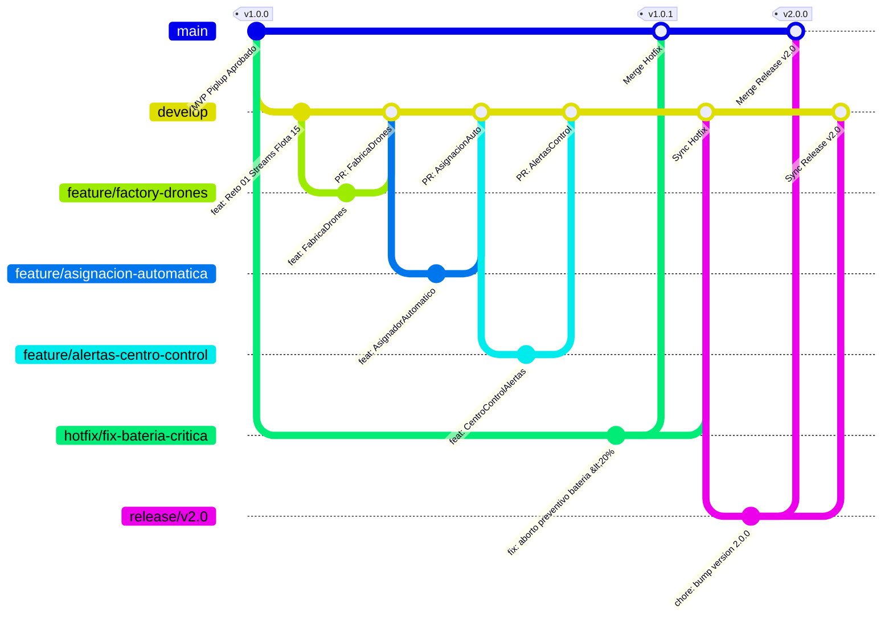

# 🐧 Prinplup — AquaPort v2: Flota Autónoma con Alertas

> **Nivel Intermedio de Evolución del Sistema AquaPort (ECI)**  
> 15 drones especializados de 3 tipos, asignación autónoma basada en condiciones hídricas, alertas de anomalías y precedencia absoluta de misiones críticas.  
> *En esta fase el sistema decide solo: el operador humano supervisa, no asigna.*

---

## 🌊 Contexto Operativo v2

La Escuela Colombiana de Ingeniería Julio Garavito (ECI) expande su infraestructura de monitoreo ambiental acuático a **15 drones** agrupados en tres categorías especializadas:

| Tipo de Drone | Entorno Operativo | Capacidad Máxima | Propósito Principal |
|---|---|---|---|
| 🚤 **Superficial** (`DroneSuperficial`) | Zonas tranquilas de embalses y lagunas | Hasta **500 g** (0.50 kg) | Transporte rápido de muestras superficiales y reactivos ligeros. |
| 🚢 **Semisumergido** (`DroneSemisumergido`) | Aguas agitadas, canales y corrientes moderadas | Hasta **1.50 kg** (1.50 kg) | Transporte de sensores hidrológicos pesados y navegación resiliente. |
| 🤿 **Buceador** (`DroneBuceador`) | Inmersión subacuática y aguas profundas | Hasta **300 g** (0.30 kg) | Extracción de muestras de sedimentos y parámetros en el fondo hídrico. |

### 🔄 Flujo Autónomo de Asignación v2

$$\text{Solicitud de Misión} \longrightarrow \text{Consulta Condiciones del Agua} \longrightarrow \text{Filtrado por Zona y Tipo} \longrightarrow \text{Estrategia de Selección Óptima} \longrightarrow \text{Validación} \longrightarrow \text{Asignación Automática} \longrightarrow \text{Alerta al Centro de Control}$$

---

## 🧩 Modelo de Dominio Ampliado

* **`EstadoDrone` (Enum):**  
  `DISPONIBLE`, `EN_MISION`, `RECARGANDO`, `MANTENIMIENTO`, `SUMERGIDO`.  
  *Contiene métodos utilitarios como `isDisponible()` y `isActivo()`.*
* **`Prioridad` (Enum):**  
  `CRITICA` *(Precedencia absoluta por contingencia o derrame)*, `ALTA`, `NORMAL`, `BAJA`.
* **`DroneAcuatico` (Clase Abstracta):**  
  Base polimórfica inmutable con atributos `id`, `modelo`, `bateria`, `estado`, `zona`, `capacidadCargaKg` y método abstracto `getTipo()`.
* **Subclases Especializadas:**  
  * [`DroneSuperficial`](file:///Prinplup/src/aquaport/model/DroneSuperficial.java)
  * [`DroneSemisumergido`](file:///Prinplup/src/aquaport/model/DroneSemisumergido.java)
  * [`DroneBuceador`](file:///Prinplup/src/aquaport/model/DroneBuceador.java)
* **`Mision`:**  
  Asocia ruta (`puntoPartida`, `puntoLlegada`), `prioridad`, `drone`, `tipoCarga` y `estado`.

---

## 🎯 Reto 01: Streams & Lambdas Avanzados en Flota de 15 Drones

Implementado en el servicio [`ConsultorFlotaAvanzado`](file:///Prinplup/src/aquaport/service/ConsultorFlotaAvanzado.java) bajo el paradigma de pipelines funcionales puros (sin bucles mutables ni efectos colaterales).

### 1️⃣ Agrupar drones disponibles por tipo de drone (`groupingBy`)
```java
Map<TipoDrone, List<DroneAcuatico>> disponiblesPorTipo = flota.stream()
        .filter(DroneAcuatico::isDisponible)
        .collect(Collectors.groupingBy(DroneAcuatico::getTipo));
```
* **Resultado:**  
  * **Superficial (2 disponibles):** `DS-01` (Bat: 95%), `DS-03` (Bat: 40%).  
  * **Semisumergido (3 disponibles):** `DM-01` (Bat: 88%), `DM-03` (Bat: 90%), `DM-04` (Bat: 55%).  
  * **Buceador (3 disponibles):** `DB-01` (Bat: 92%), `DB-03` (Bat: 65%), `DB-04` (Bat: 30%).

---

### 2️⃣ Obtener el drone óptimo para una zona dada (mayor batería, tipo compatible)
```java
Optional<DroneAcuatico> optimo = flota.stream()
        .filter(DroneAcuatico::isDisponible)
        .filter(drone -> zona.equalsIgnoreCase(drone.getZona()))
        .filter(drone -> drone.getTipo() == tipoCompatible)
        .max(Comparator.comparingInt(DroneAcuatico::getBateria));
```
* **Caso aplicado:** En `"Embalse Norte"` con requerimiento `SEMISUMERGIDO` $\longrightarrow$ Selecciona **`DM-03`** (Batería: 90%).

---

### 3️⃣ Calcular el promedio de batería por tipo de drone (`averagingDouble`)
```java
Map<TipoDrone, Double> promedios = flota.stream()
        .collect(Collectors.groupingBy(
                DroneAcuatico::getTipo,
                Collectors.averagingDouble(DroneAcuatico::getBateria)
        ));
```
* **Resultados en la flota de 15 drones:**  
  * 🚢 **Semisumergido:** `65.6%`  
  * 🤿 **Buceador:** `55.4%`  
  * 🚤 **Superficial:** `46.4%`

---

### 4️⃣ Separar misiones CRÍTICAS de las demás (`partitioningBy`)
```java
Map<Boolean, List<Mision>> particionadas = misiones.stream()
        .collect(Collectors.partitioningBy(
                mision -> mision.getPrioridad() == Prioridad.CRITICA
        ));
```
* **`true` (Misiones Críticas):**  
  * `MIS-202` (Embalse Norte $\rightarrow$ Bahía Ciencia, Drone `DM-03`).  
  * `MIS-204` (Bahía Ciencia $\rightarrow$ Laguna Sur, Drone `DB-01`).
* **`false` (Misiones Regulares / Otras Prioridades):**  
  * `MIS-201` (NORMAL), `MIS-203` (ALTA), `MIS-205` (BAJA).

---

### 5️⃣ Listar todas las zonas únicas que cubre la flota activa (`distinct`, `sorted`)
```java
List<String> zonas = flota.stream()
        .filter(DroneAcuatico::isActivo)
        .map(DroneAcuatico::getZona)
        .distinct()
        .sorted()
        .toList();
```
* **Zonas cubiertas:** `Bahía Ciencia`, `Canal Central`, `Dársena Oeste`, `Embalse Norte`, `Laboratorio Hídrico`, `Laguna Sur`, `Punto Ribereño Este`.

---

### ➕ Operación Complementaria: Cola de Misiones por Precedencia y Batería
```java
List<Mision> ordenadas = misiones.stream()
        .sorted(Comparator.comparing((Mision m) -> m.getPrioridad().getNivel())
                .thenComparing(m -> m.getDrone().getBateria(), Comparator.reverseOrder()))
        .toList();
```
*Garantiza que las misiones de mayor urgencia se despachen primero, y ante igual nivel de prioridad se favorezca el drone con mayor reserva energética.*

---

## 🌿 GitHub y GitFlow en AquaPort v2 (Reto 02)

Estrategia formal de ramas bajo el modelo **GitFlow** implementada para el ciclo de vida de la versión 2.0:



### 📋 Mapeo de Ramas y Responsabilidades en el Repositorio

| Rama | Tipo GitFlow | Origen | Destino | Propósito / Alcance | Enlace / PR en GitHub |
|---|---|---|---|---|---|
| **`main`** | Producción | — | — | Código estable aprobado en producción (`v1.0.0`, `v1.0.1`, `v2.0.0`). | [Rama `main`](https://github.com/Oscar10lm/MaterialRefuerzoPiplup/tree/main) |
| **`develop`** | Integración | `main` | `main` (vía release) | Integración continua de features completadas de la versión 2. | [Rama `develop`](https://github.com/Oscar10lm/MaterialRefuerzoPiplup/tree/develop) |
| **`feature/factory-drones`** | Feature | `develop` | `develop` | Implementación del patrón Factory Method ([`FabricaDrones`](file:///Prinplup/src/aquaport/service/FabricaDrones.java)) para creación de drones polimórficos. | [PR `feature/factory-drones`](https://github.com/Oscar10lm/MaterialRefuerzoPiplup/pull/new/feature/factory-drones) |
| **`feature/asignacion-automatica`** | Feature | `develop` | `develop` | Asignación inteligente y autónoma según agitación hídrica y carga ([`AsignadorAutomaticoMisiones`](file:///Prinplup/src/aquaport/service/AsignadorAutomaticoMisiones.java)). | [PR `feature/asignacion-automatica`](https://github.com/Oscar10lm/MaterialRefuerzoPiplup/pull/new/feature/asignacion-automatica) |
| **`feature/alertas-centro-control`** | Feature | `develop` | `develop` | Despacho y monitoreo automático de alertas ante batería crítica y fallos ([`CentroControlAlertas`](file:///Prinplup/src/aquaport/service/CentroControlAlertas.java)). | [PR `feature/alertas-centro-control`](https://github.com/Oscar10lm/MaterialRefuerzoPiplup/pull/new/feature/alertas-centro-control) |
| **`hotfix/fix-bateria-critica`** | Hotfix | `main` | `main` & `develop` | Parche urgente en caliente sobre producción: evaluación de batería crítica $< 20\%$ con aborto preventivo. | [PR `hotfix/fix-bateria-critica`](https://github.com/Oscar10lm/MaterialRefuerzoPiplup/pull/new/hotfix/fix-bateria-critica) |
| **`release/v2.0`** | Release | `develop` | `main` & `develop` | Estabilización, incremento de versión a `2.0.0` y verificación pre-despliegue. | [PR `release/v2.0`](https://github.com/Oscar10lm/MaterialRefuerzoPiplup/pull/new/release/v2.0) |

### 🏷️ Tags de Versión Oficiales

* **`v1.0.0`**: MVP AquaPort (Piplup) con 14 retos aprobados.
* **`v1.0.1`**: Hotfix urgente sobre producción para validación preventiva de batería crítica $< 20\%$.
* **`v2.0.0`**: AquaPort v2 (Prinplup) — Flota autónoma multimodal de 15 drones con asignación inteligente y alertas.

---

## 🏗️ Patrones de Diseño de la v2 (Reto 03)

La arquitectura de AquaPort v2 integra tres patrones fundamentales del GoF:

### 1. 🏭 Factory Method — ¿Cómo crear cada tipo de drone?
* **Componente:** [`FabricaDrones`](file:///Prinplup/src/aquaport/service/FabricaDrones.java).
* **Rol:** Encapsula la decisión de qué subclase polimórfica instanciar (`DroneSuperficial`, `DroneSemisumergido`, `DroneBuceador`) según el `TipoDrone` solicitado.
* **Ventaja:** Incorporar nuevos tipos de drones no requiere tocar la lógica del asignador ni del consultor de flota (principio OCP).

### 2. 🧭 Strategy — ¿Qué drone elegir?
* **Contrato:** [`EstrategiaSeleccionDrone`](file:///Prinplup/src/aquaport/service/strategy/EstrategiaSeleccionDrone.java).
* **Estrategias concretas:**
  * [`MayorBateriaStrategy`](file:///Prinplup/src/aquaport/service/strategy/MayorBateriaStrategy.java): Maximiza la reserva energética.
  * [`ZonaCercanaStrategy`](file:///Prinplup/src/aquaport/service/strategy/ZonaCercanaStrategy.java): Prioriza proximidad física para reducir traslados en vacío.
  * [`PrioridadCriticaStrategy`](file:///Prinplup/src/aquaport/service/strategy/PrioridadCriticaStrategy.java): Exige batería $\ge 50\%$ y favorece drones de máxima robustez.
* **Cero violaciones:** El [`AsignadorAutomaticoMisiones`](file:///Prinplup/src/aquaport/service/AsignadorAutomaticoMisiones.java) no contiene sentencias `instanceof`, delegando de forma 100% polimórfica en la estrategia activa.

### 3. 📢 Observer — ¿Quién se entera del fallo?
* **Contrato:** [`ObservadorFalloDrone`](file:///Prinplup/src/aquaport/service/observer/ObservadorFalloDrone.java).
* **Observadores concretos:**
  * [`CentroControlObserver`](file:///Prinplup/src/aquaport/service/observer/CentroControlObserver.java): Despacha alarmas de monitoreo y telemetría.
  * [`TecnicoMantenimientoObserver`](file:///Prinplup/src/aquaport/service/observer/TecnicoMantenimientoObserver.java): Genera órdenes de trabajo inmediatas para el equipo técnico.
* **Desacoplamiento:** Los observadores se suscriben o desuscriben dinámicamente (`agregarObservador`, `removerObservador`) sin tocar las clases de dominio.

### 🧪 Verificación con Mockito (Notificación Exactamente 1 Vez)
Prueba automatizada en [`PatronesDisenoIntegracionTest.java`](file:///Prinplup/test/aquaport/service/PatronesDisenoIntegracionTest.java):
```java
// Al registrar una misión con drone en estado FALLO:
assertThrows(IllegalStateException.class, () -> asignador.registrarMision(misionConFallo));

// Mockito verifica que cada observador registrado fue notificado exactamente 1 vez:
verify(mockCentroControl, times(1)).notificarFallo(eq(droneEnFallo), anyString());
verify(mockTecnicoMantenimiento, times(1)).notificarFallo(eq(droneEnFallo), anyString());
verifyNoMoreInteractions(mockCentroControl);
verifyNoMoreInteractions(mockTecnicoMantenimiento);
```

---

## 🧪 Pruebas Unitarias (TDD / JUnit 5 / Mockito)

La suite de pruebas contiene **29 pruebas unitarias** pasando al 100%:
* [`ConsultorFlotaAvanzadoTest.java`](file:///Prinplup/test/aquaport/service/ConsultorFlotaAvanzadoTest.java) (12 pruebas)
* [`PatronesDisenoIntegracionTest.java`](file:///Prinplup/test/aquaport/service/PatronesDisenoIntegracionTest.java) (5 pruebas con Mockito)
* [`FabricaDronesTest.java`](file:///Prinplup/test/aquaport/service/FabricaDronesTest.java) (4 pruebas)
* [`AsignadorAutomaticoMisionesTest.java`](file:///Prinplup/test/aquaport/service/AsignadorAutomaticoMisionesTest.java) (4 pruebas)
* [`CentroControlAlertasTest.java`](file:///Prinplup/test/aquaport/service/CentroControlAlertasTest.java) (4 pruebas)

```powershell
mvn -f Prinplup/pom.xml test
```

---

## 💻 Ejecución de la Demostración

```powershell
# Compilación y ejecución directa con Maven:
mvn -f Prinplup/pom.xml compile exec:java -Dexec.mainClass="aquaport.MainPrinplup"

# O mediante javac/java:
javac -d Prinplup/target/classes Prinplup/src/aquaport/model/*.java Prinplup/src/aquaport/service/*.java Prinplup/src/aquaport/*.java
java -cp Prinplup/target/classes aquaport.MainPrinplup
```

