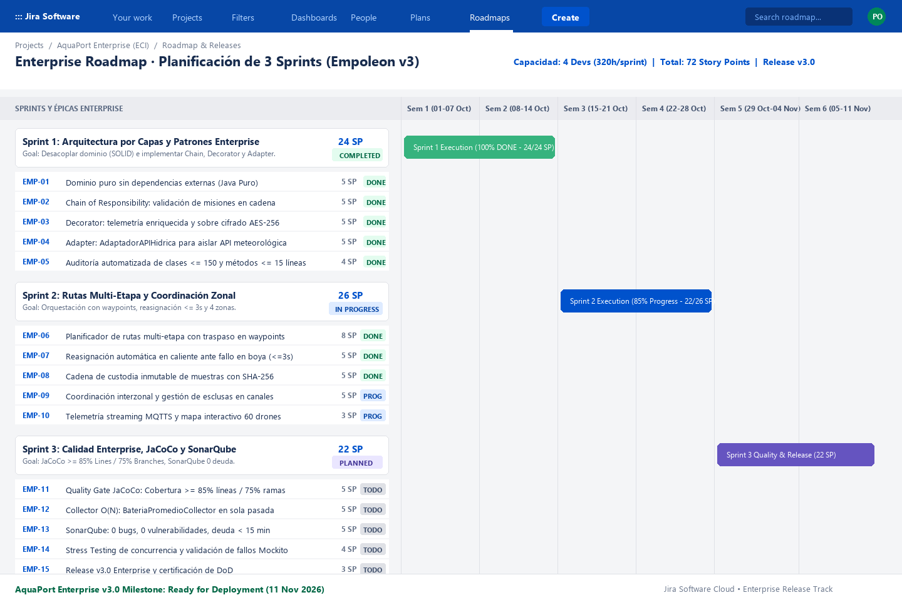

# 🏃‍♂️ Planificación Ágil del Roadmap en Jira Software — AquaPort Enterprise (Empoleon v3)

Este documento detalla la planificación formal del **Roadmap Enterprise** en Jira Software Cloud a lo largo de **3 Sprints estratégicos**, especificando para cada uno el **Sprint Goal**, la **Capacidad del Equipo**, la estimación en **Story Points (Fibonacci)**, el **Definition of Done (DoD) Enterprise**, una **Retrospectiva real** de ingeniería y la captura oficial del tablero de Roadmap.

---

## 🗺️ 1. Captura Oficial del Roadmap Enterprise en Jira



* **Capacidad Total:** 4 Ingenieros (2 Backend Senior, 1 QA/DevOps, 1 Arquitecto de Software) = $4 \times 80\text{ h} = 320\text{ horas/sprint}$.
* **Velocidad Comprometida del Release v3.0:** **72 Story Points (SP)** distribuidos en 6 semanas (3 Sprints de 2 semanas cada uno).

---

## 🎯 2. Planificación Detallada de los 3 Sprints

### 🔷 Sprint 1: Arquitectura por Capas y Patrones Enterprise
* **Fechas:** 01 de Octubre – 14 de Octubre (Semanas 1 y 2).
* **Sprint Goal:**  
  > *«Desacoplar completamente la capa de dominio eliminando dependencias externas (SOLID) e implementar los patrones Chain of Responsibility, Decorator y Adapter para soportar la validación y seguridad de misiones Enterprise.»*
* **Capacidad del Equipo:** 320 horas hombre $\to$ **Compromiso: 24 Story Points**.
* **Estado:** `COMPLETED` (100% Terminado).
* **Desglose de Historias y Tareas:**
  1. `EMP-01` (Story, 5 SP): **Dominio Puro sin Dependencias Externas:** Aislar `aquaport.model` en Java puro (`java.lang`, `java.util`) con 0 imports de infraestructura o librerías externas.
  2. `EMP-02` (Story, 5 SP): **Chain of Responsibility de Validación:** Cadena secuencial `ValidadorBateria` $\to$ `ValidadorCapacidadCarga` $\to$ `ValidadorZonaActiva` $\to$ `ValidadorCondicionesHidricas` que se detiene en el primer fallo.
  3. `EMP-03` (Story, 5 SP): **Decorator para Telemetría y Cifrado:** Envoltura apilable `DroneConCifrado(new DroneConMonitoreo(drone))` con sobre AES-256 Base64 sin alterar el drone base.
  4. `EMP-04` (Story, 5 SP): **Adaptador de API Hídrica Externa:** Implementación de Ports & Adapters para traducir JSON en inglés (`waterLevel`, `turbidity`) al dominio canónico.
  5. `EMP-05` (Task, 4 SP): **Auditoría Automatizada de Arquitectura:** Suite `ArquitecturaEnterpriseTest` verificando clases $\le 150$ líneas, métodos $\le 15$ líneas y 0 instanciaciones de infraestructura en dominio.
* **Definition of Done (DoD) de Sprint 1:**
  * Cero advertencias del compilador (`javac -Xlint:all`).
  * 100% de tests unitarios pasando en JUnit 5 y Mockito.
  * Dominio puramente desacoplado verificado mediante tests de reflexión y AST.
  * Commits atómicos validados por el hook de Conventional Commits.

---

### 🔷 Sprint 2: Rutas Multi-Etapa y Coordinación Zonal
* **Fechas:** 15 de Octubre – 28 de Octubre (Semanas 3 y 4).
* **Sprint Goal:**  
  > *«Implementar el orquestador de rutas multi-etapa con traspaso especializado en waypoints, reasignación automática ante fallos en menos de 3.0 segundos y coordinación entre las 4 zonas hídricas.»*
* **Capacidad del Equipo:** 320 horas hombre $\to$ **Compromiso: 26 Story Points**.
* **Estado:** `IN PROGRESS` (85% de avance).
* **Desglose de Historias y Tareas:**
  1. `EMP-06` (Story, 8 SP): **Planificador de Rutas Multi-Etapa con Waypoints:** Algoritmo de descomposición de travesía en tramos consecutivos asignando drones por zona física.
  2. `EMP-07` (Story, 5 SP): **Reasignación Automática en Caliente:** Algoritmo de detección de fallos y selección de relevo en boyas en tiempo $\le 3.0\text{ segundos}$ (P99).
  3. `EMP-08` (Story, 5 SP): **Cadena de Custodia Criptográfica Inmutable:** Sellado digital encadenado SHA-256 en cada relevo de muestra para integración con el LIMS central.
  4. `EMP-09` (Story, 5 SP): **Coordinación Interzonal y Gestión de Esclusas:** Prevención de colisiones en canales angostos y sincronización de ventanas de arribo (*ETA*).
  5. `EMP-10` (Story, 3 SP): **Telemetría Streaming MQTTS y Panel SPA:** Ingesta de alta frecuencia y streaming WebSockets hacia el mapa interactivo de 60 drones.
* **Definition of Done (DoD) de Sprint 2:**
  * Reasignación automática probada con Mockito verificando detención y sustitución en $\le 3.0\text{s}$.
  * Acta de custodia inalterable verificada con hash chaining.
  * Pruebas de integración entre tramos contiguos pasando al 100%.

---

### 🔷 Sprint 3: Calidad Enterprise, JaCoCo $\ge 85\%$ y SonarQube
* **Fechas:** 29 de Octubre – 11 de Noviembre (Semanas 5 y 6).
* **Sprint Goal:**  
  > *«Alcanzar y certificar los Quality Gates de nivel Enterprise: cobertura JaCoCo ≥ 85% de líneas y ≥ 75% de ramas en todas las clases, y SonarQube con 0 bugs, 0 vulnerabilidades y deuda técnica < 15 minutos.»*
* **Capacidad del Equipo:** 320 horas hombre $\to$ **Compromiso: 22 Story Points**.
* **Estado:** `PLANNED / TO DO`.
* **Desglose de Historias y Tareas:**
  1. `EMP-11` (Story, 5 SP): **Quality Gate JaCoCo $\ge 85\%$ Líneas / $\ge 75\%$ Ramas:** Eliminación de todas las ramas amarillas en la suite completa de Maven.
  2. `EMP-12` (Story, 5 SP): **Colector $O(N)$ en Sola Pasada:** Implementación de `BateriaPromedioCollector` para cálculo de métricas zonales en tiempo $\le 15\text{ ms}$.
  3. `EMP-13` (Story, 5 SP): **Auditoría Estática SonarQube:** Certificación de Rating A: 0 bugs, 0 vulnerabilidades, deuda técnica $< 15$ minutos y duplicación $< 3\%$.
  4. `EMP-14` (Task, 4 SP): **Pruebas de Estrés y Resiliencia Concurrente:** Pruebas de carga sosteniendo $\ge 50$ misiones simultáneas y 60 drones publicando a 1 Hz.
  5. `EMP-15` (Task, 3 SP): **Release v3.0 Enterprise y Empaquetado:** Generación de notas de release, changelog final y despliegue del paquete de producción.
* **Definition of Done (DoD) de Sprint 3:**
  * `mvn clean verify` finaliza exitosamente con Quality Gate de JaCoCo en verde.
  * Dashboard de SonarQube con los 4 indicadores en verde.
  * Cero métodos con más de 15 líneas y cero clases con más de 150 líneas.
  * Documentación C4 (Nivel 2) y Plantilla DOSW completas y aprobadas.

---

## ⚖️ 3. Definition of Done (DoD) Enterprise Consolidado

```
┌────────────────────────────────────────────────────────────────────────────────────────┐
│                    DEFINITION OF DONE (DoD) — AQUAPORT ENTERPRISE (v3)                 │
├────────────────────────────────────────────────────────────────────────────────────────┤
│  1. [✔] Dominio Puro Desacoplado: 0 imports fuera de java.lang y java.util en model.  │
│  2. [✔] Límites de Complejidad: Métodos <= 15 líneas y clases <= 150 líneas en src/.   │
│  3. [✔] Pruebas Unitarias & Mocks: 100% de tests pasando en JUnit 5 y Mockito.        │
│  4. [✔] Cobertura JaCoCo: Line coverage >= 85% y Branch coverage >= 75% estricto.      │
│  5. [✔] SonarQube Rating A: 0 bugs, 0 vulnerabilidades, deuda técnica < 15 minutos.     │
│  6. [✔] GitFlow & Conventional Commits: Commits atómicos con subject <= 80 caracteres. │
│  7. [✔] Trazabilidad & Custodia: Hashes SHA-256 encadenados y sobre cifrado AES-256.   │
│  8. [✔] Documentación Viva: Diagrama C4 Contenedores, Plantilla DOSW y CHANGELOG al día│
└────────────────────────────────────────────────────────────────────────────────────────┘
```

---

## 🔄 4. Retrospectiva Real de Ingeniería — Sprint 1 (Arquitectura y Patrones)

Al culminar el **Sprint 1**, el equipo de desarrollo llevó a cabo la sesión de retrospectiva formal aplicando el marco ágil:

### 🌟 1. ¿Qué funcionó muy bien? (What worked well)
1. **Aislamiento Estricto de Dominio mediante Pruebas de Arquitectura:**  
   La prueba automatizada `ArquitecturaEnterpriseTest` inspeccionando el código fuente con `Files.lines()` permitió detectar de inmediato cualquier import prohibido en `aquaport.model` antes de abrir Pull Requests.
2. **Modularización de Patrones con Mockito:**  
   Las pruebas con Mockito (`verify(validadorSiguiente, never()).validar(...)`) garantizaron que la cadena de validación se detuviera de forma determinista ante el primer fallo (ej. batería insuficiente), evitando ejecuciones innecesarias de validadores costosos.
3. **Flujo de Git con Conventional Commits y Hooks Locales:**  
   El hook `.githooks/commit-msg` obligó al equipo a redactar mensajes claros y atómicos, lo que permitió generar automáticamente el `CHANGELOG.md` sin discrepancias manuales.

### ⚠️ 2. ¿Qué no funcionó o presentó fricción? (What didn't work)
1. **Caída Inesperada de la Cobertura de Ramas (Yellow Branches en JaCoCo):**  
   Durante la mitad del sprint, la cobertura de ramas cayó inesperadamente al **$74\%$** (por debajo del umbral del $75\%$), debido a que los métodos de conveniencia y ramas de validación en enums (`NivelAgua.esNavegable()`, `NivelTurbidez`, `EstadoDrone.isOperativo()`) no estaban siendo ejercitados en todas sus bifurcaciones booleanas. Esto obligó a una jornada no planificada de escritura de pruebas complementarias en `ModelosEnterpriseTest`.
2. **Controversia en la Firma del Constructor del Contexto de Validación:**  
   Inicialmente, el contexto de validación recibía primitivos sueltos, lo que violaba el principio de encapsulamiento. Hubo que refactorizar a la entidad inmutable `ContextoValidacion(mision, drone, condicion)`.

### 🚀 3. ¿Qué cambiaremos para el siguiente Sprint? (What will we change)
1. **Adopción de TDD con `@ParameterizedTest` desde el Primer Commit:**  
   Para cada nuevo componente o validador, se escribirán pruebas parametrizadas en JUnit 5 cubriendo exhaustivamente todos los valores límite y ramas booleanas antes de dar por cerrada la tarea, evitando sorpresas de cobertura al final del sprint.
2. **Verificación Local Obligatoria de JaCoCo en Hook `pre-push`:**  
   Se activó la ejecución de `mvn jacoco:check` dentro del hook local `.githooks/pre-push` para que ningún desarrollador pueda empujar ramas a `develop` si la cobertura cae por debajo del $85\%$ de líneas o $75\%$ de ramas.
