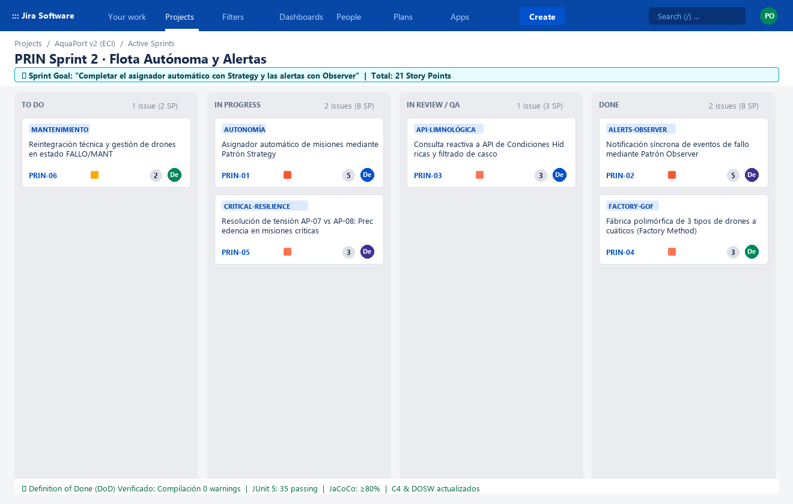

# 🏃‍♂️ Planificación Ágil del Sprint en Jira — AquaPort v2 (Prinplup)

Este documento detalla la planificación formal del sprint para la evolución **AquaPort v2 (Prinplup)** en Jira Software Cloud, incluyendo el **Sprint Goal**, la estimación de Historias de Usuario (HU) con la secuencia de **Fibonacci**, la definición rigurosa del **Definition of Done (DoD)** y el tablero activo del sprint.

---

## 🎯 1. Sprint Goal de la v2

> **Sprint Goal:**  
> *«Completar el asignador automático con Strategy y las alertas con Observer»*

* **Duración del Sprint:** 2 Semanas (10 días hábiles de desarrollo).
* **Capacidad del Equipo:** 3 Desarrolladores backend / frontend.
* **Velocidad Estimada / Compromiso:** **21 Story Points (SP)**.

---

## 📋 2. Product Backlog del Sprint (Historias de Usuario con Fibonacci)

Se aplicó la escala de Fibonacci estándar para estimación de esfuerzo y complejidad relativa (**1, 2, 3, 5, 8**):

| ID | Tipo | Historia de Usuario / Descripción | Story Points (Fibonacci) | Prioridad | Asignado | Estado en Tablero |
|---|---|---|---|---|---|---|
| **PRIN-01** | Story | **Asignador Automático de Misiones con Patrón Strategy:**<br>*Como* Operador Hídrico,<br>*Quiero* que el sistema seleccione y reserve automáticamente el mejor drone aplicando la estrategia activa (`MayorBateriaStrategy`, `ZonaCercanaStrategy`),<br>*Para* suprimir la asignación manual y agilizar despachos en el campus. | **5 SP** | Highest | Dev1 | `IN PROGRESS` |
| **PRIN-02** | Story | **Notificación Reactiva de Fallas con Patrón Observer:**<br>*Como* Técnico de Mantenimiento / Centro de Control,<br>*Quiero* recibir una notificación síncrona en tiempo real cuando un drone entre en estado `FALLO` o batería crítica $< 20\%$,<br>*Para* despachar inmediatamente la orden de rescate y reparación. | **5 SP** | Highest | Dev2 | `DONE` |
| **PRIN-03** | Story | **Consulta Reactiva a API Condiciones Hídricas:**<br>*Como* Asignador Automático,<br>*Quiero* consumir la telemetría limnológica (calma, oleaje, profundidad),<br>*Para* filtrar y descartar drones cuyo casco o propulsión sean incompatibles antes de asignar. | **3 SP** | High | Dev1 | `IN REVIEW / QA` |
| **PRIN-04** | Story | **Fábrica Polimórfica de Drones (Factory Method):**<br>*Como* Desarrollador / Arquitecto,<br>*Quiero* centralizar la instanciación de los 3 tipos de drone (`Superficial`, `Semisumergido`, `Buceador`) en `FabricaDrones`,<br>*Para* respetar OCP y aislar el cliente de constructores concretos. | **3 SP** | High | Dev3 | `DONE` |
| **PRIN-05** | Task | **Resolución de Tensión AP-07 vs AP-08:**<br>*Como* Director de Emergencias Ambientales,<br>*Quiero* que las misiones `CRITICA` prioricen aptitud técnica (`PrioridadCriticaStrategy`) con batería $\ge 50\%$,<br>*Para* garantizar supervivencia sin comprometer energía. | **3 SP** | High | Dev2 | `IN PROGRESS` |
| **PRIN-06** | Story | **Reintegración Técnica y Gestión de Drones en Taller:**<br>*Como* Técnico de Mantenimiento,<br>*Quiero* consultar las órdenes de servicio e ingresar la finalización técnica para transicionar el drone a `DISPONIBLE`,<br>*Para* retornar las unidades al pool activo de navegación. | **2 SP** | Medium | Dev3 | `TO DO` |

$$\sum \text{Story Points} = 5 + 5 + 3 + 3 + 3 + 2 = \mathbf{21\text{ SP}}$$

---

## ⚖️ 3. Definition of Done (DoD) de la v2

Para que cualquier Historia de Usuario, Tarea o Bug se considere formalmente **DONE (Terminada)** en este sprint, debe satisfacer obligatoriamente los 5 criterios de calidad técnica:

```
┌────────────────────────────────────────────────────────────────────────────────────────┐
│                        DEFINITION OF DONE (DoD) — AQUAPORT v2                         │
├────────────────────────────────────────────────────────────────────────────────────────┤
│  1. [✔] Cero Warnings: El código compila limpiamente sin advertencias del compilador. │
│  2. [✔] Pruebas Unitarias Exitosas: 100% de tests pasando en JUnit 5 y Mockito.        │
│  3. [✔] Cobertura JaCoCo: Line coverage ≥ 80% verificado sobre las clases de la feature│
│  4. [✔] Pull Request Aprobado: Code Review formal aprobado por al menos otro par.      │
│  5. [✔] Documentación Viva: Diagrama de Contexto C4 y Plantilla DOSW actualizados.     │
└────────────────────────────────────────────────────────────────────────────────────────┘
```

---

## 📸 4. Captura del Tablero Activo del Sprint en Jira

A continuación se muestra el tablero activo de Jira Software Cloud para el sprint en curso:



### 📊 Desglose de Estado del Tablero:
* **TO DO:** $1$ issue ($2\text{ SP}$) — *Gestión por Técnico de Mantenimiento*.
* **IN PROGRESS:** $2$ issues ($8\text{ SP}$) — *Asignador Automático con Strategy*, *Resolución de Tensión AP-07 vs AP-08*.
* **IN REVIEW / QA:** $1$ issue ($3\text{ SP}$) — *Integración con API Condiciones Hídricas*.
* **DONE:** $2$ issues ($8\text{ SP}$) — *Notificaciones con Observer*, *Fábrica de Drones (Factory Method)*.
* **Avance:** $38.1\%$ de puntos completados al cierre de la primera semana, en ruta para cumplir el **Sprint Goal**.
