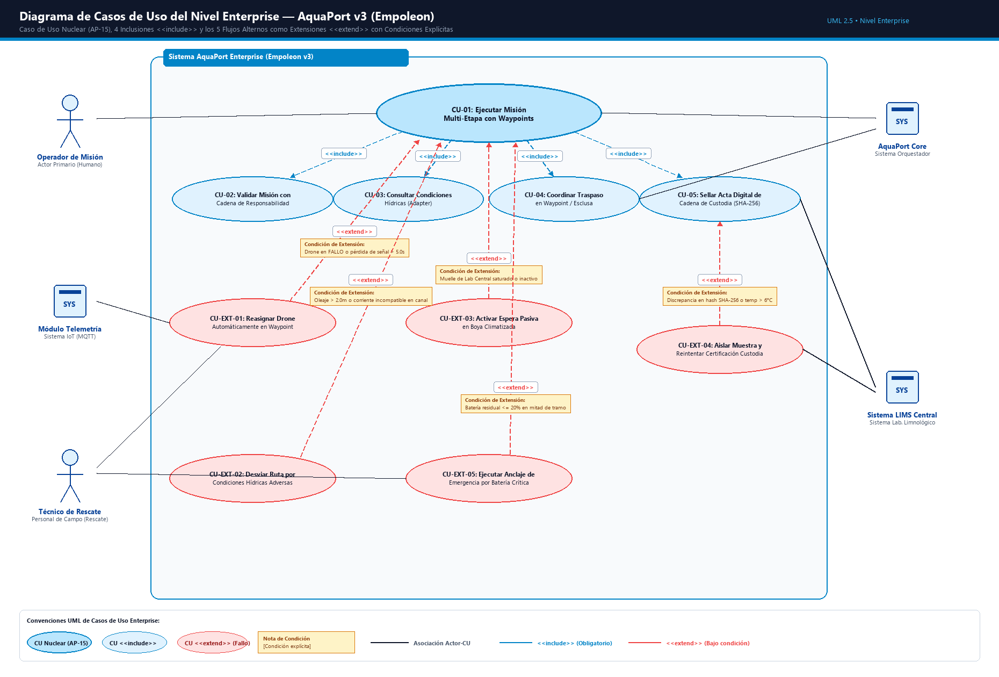

# 📐 Especificación y Diagrama de Casos de Uso — AquaPort Enterprise (Empoleon v3)

Este documento detalla la arquitectura funcional del modelo de Casos de Uso para el nivel **AquaPort Enterprise (v3)**, estructurando el Caso de Uso Nuclear (`AP-15`), las cuatro inclusiones obligatorias (`<<include>>`), los actores participantes y los **cinco flujos alternos modelados como extensiones (`<<extend>>`) con sus condiciones de activación formalmente explicitadas**.

---

## 🖼️ 1. Diagrama Oficial de Casos de Uso Enterprise



* **Archivo de imagen:** [`docs/diagrama-cu-empoleon.png`](file:///docs/diagrama-cu-empoleon.png)
* **Definición PlantUML:** [`docs/diagrama-cu-empoleon.puml`](file:///docs/diagrama-cu-empoleon.puml)
* **Script Generador en Python (PIL):** [`docs/generate_cu_empoleon_img.py`](file:///docs/generate_cu_empoleon_img.py)

---

## 👥 2. Catálogo de Actores

| Actor | Tipo UML | Rol y Responsabilidad en AquaPort Enterprise |
|---|---|---|
| **Operador de Misión** | Actor Primario (Humano) | Personal científico o técnico de control que parametriza misiones multi-etapa, selecciona waypoints y supervisa alertas de navegación. |
| **AquaPort Core Service** | Actor Secundario (Sistema) | Motor orquestador backend que descompone rutas, evalúa la *Chain of Responsibility*, despacha drones y sincroniza las 4 zonas hídricas. |
| **Módulo de Telemetría** | Actor Secundario (Sistema IoT) | Ingesta de alta frecuencia sobre MQTTS, procesa el decorador `DroneConMonitoreo`, desencripta sobres AES-256 y notifica fallos en $\le 5\text{s}$. |
| **Sistema LIMS Central** | Actor Externo (Sistema) | Sistema de Gestión de Información del Laboratorio Limnológico Central; valida y liquida actas de cadena de custodia. |
| **Técnico de Rescate Acuático** | Actor de Soporte (Humano) | Brigadista náutico de campo que acude físicamente ante anclajes de emergencia o drones con batería crítica varados en boyas. |

---

## 🎯 3. Caso de Uso Nuclear y Relaciones de Inclusión (`<<include>>`)

### Caso de Uso Central
* **`CU-01: Ejecutar Misión Multi-Etapa con Waypoints` (Caso Base):**  
  Representa el flujo integral de negocio: planificación de la ruta, validación secuencial, asignación de flota especializada, relevos coordinados en boyas y entrega certificada de muestras en el Laboratorio Hídrico Central.

### Casos de Uso Incluidos Obligatoriamente (`<<include>>`)
1. **`CU-02: Validar Misión con Cadena de Responsabilidad` (`<<include>>`):**  
   *Justificación:* Ningún tramo puede iniciarse sin pasar por la cadena: `ValidadorBateria` $\to$ `ValidadorCapacidadCarga` $\to$ `ValidadorZonaActiva` $\to$ `ValidadorCondicionesHidricas`.
2. **`CU-03: Consultar Condiciones Hídricas Zonales (Adapter)` (`<<include>>`):**  
   *Justificación:* Obligatorio para traducir los parámetros limnológicos de la API externa en inglés (`waterLevel`, `turbidity`) al dominio puro.
3. **`CU-04: Coordinar Traspaso Físico en Waypoint / Esclusa` (`<<include>>`):**  
   *Justificación:* Esencia de la misión multi-etapa; garantiza la sincronización de compuertas y el depósito/recogida del contenedor de muestra.
4. **`CU-05: Sellar Acta Digital de Cadena de Custodia (SHA-256)` (`<<include>>`):**  
   *Justificación:* En cada relevo físico y al arribo final, es obligatorio generar el hash criptográfico encadenado para garantizar la validez científica y legal de la muestra.

---

## 🔀 4. Los 5 Flujos Alternos como Extensiones (`<<extend>>`) con Condiciones Explícitas

En el estándar UML 2.5, una relación `<<extend>>` modela un comportamiento opcional, excepcional o contingente que se inserta en el caso de uso base únicamente cuando se cumple una **condición de guarda** específica.

```
                              ┌──────────────────────────────────────────────────┐
                              │            5 EXTENSIONES ENTERPRISE              │
                              └──────────────────────────────────────────────────┘
                                                        │
         ┌──────────────────────┬───────────────────────┼───────────────────────┬──────────────────────┐
         ▼                      ▼                       ▼                       ▼                      ▼
   ┌────────────┐         ┌────────────┐          ┌────────────┐          ┌────────────┐         ┌────────────┐
   │ CU-EXT-01  │         │ CU-EXT-02  │          │ CU-EXT-03  │          │ CU-EXT-04  │         │ CU-EXT-05  │
   │ Reasignar  │         │ Desviar    │          │ Espera     │          │ Aislar     │         │ Anclaje    │
   │ Drone en WP│         │ Ruta Clima │          │ Boya Clima │          │ Custodia   │         │ Batería 20%│
   └────────────┘         └────────────┘          └────────────┘          └────────────┘         └────────────┘
```

---

### 1. `CU-EXT-01: Reasignar Drone Automáticamente en Waypoint`
* **Caso de Uso Base Extendido:** `CU-01: Ejecutar Misión Multi-Etapa con Waypoints`
* **Condición de Extensión Explícita:**  
  `[Condición: El drone asignado entra en estado FALLO, sufre avería de propulsión o pierde telemetría > 5.0 segundos]`
* **Descripción del Comportamiento Contingente:**  
  El `Módulo de Telemetría` detecta la anomalía, asegura el drone averiado en la boya de relevo más cercana y activa el motor de reasignación en caliente del Core Service, despachando una unidad sustituta en la misma zona con batería $\ge 50\%$ en menos de **$3.0\text{ segundos}$** sin abortar la misión.
* **Actores Participantes:** `Módulo de Telemetría`, `AquaPort Core Service`, `Técnico de Rescate`.

---

### 2. `CU-EXT-02: Desviar Ruta por Condiciones Hídricas Adversas`
* **Caso de Uso Base Extendido:** `CU-01: Ejecutar Misión Multi-Etapa con Waypoints`
* **Condición de Extensión Explícita:**  
  `[Condición: Oleaje > 2.0 metros, corriente superior a 1.5 m/s o turbidez anómala incompatible con el modelo de drone asignado]`
* **Descripción del Comportamiento Contingente:**  
  El eslabón `ValidadorCondicionesHidricas` o el sensor del drone reporta riesgo inminente de naufragio. El Core consulta al GIS ECI y recalcula un corredor de desvío por canales navegables secundarios, agregando un waypoint de desvío temporal tras verificar la autonomía de batería remanente.
* **Actores Participantes:** `AquaPort Core Service`, `Operador de Misión`.

---

### 3. `CU-EXT-03: Activar Espera Pasiva en Boya Climatizada`
* **Caso de Uso Base Extendido:** `CU-01: Ejecutar Misión Multi-Etapa con Waypoints`
* **Condición de Extensión Explícita:**  
  `[Condición: Muelle de descarga del Laboratorio Hídrico Central saturado o temporalmente inactivo por mantenimiento/alerta biológica]`
* **Descripción del Comportamiento Contingente:**  
  El drone custodio del último tramo recibe instrucción de ingresar a la *Boya de Transferencia Sur*, apagando motores para ahorrar batería y activando el compresor termoeléctrico de refrigeración activa para mantener la muestra en $4.0^\circ\text{C}$ hasta la reapertura del muelle.
* **Actores Participantes:** `AquaPort Core Service`, `Operador de Misión`.

---

### 4. `CU-EXT-04: Aislar Muestra y Reintentar Certificación de Custodia`
* **Caso de Uso Base Extendido:** `CU-05: Sellar Acta Digital de Cadena de Custodia (SHA-256)`
* **Condición de Extensión Explícita:**  
  `[Condición: Discrepancia criptográfica en el hash SHA-256 encadenado o temperatura fuera del rango normativo de 4°C ± 2°C (Temp > 6.0°C)]`
* **Descripción del Comportamiento Contingente:**  
  El receptor de muestras del LIMS Central detecta una ruptura en la firma criptográfica o degradación térmica. En lugar de procesar la muestra, la marca con estado `CUARENTENA_OBSERVADA`, guarda el histórico de firmas para auditoría legal y emite una orden de repetición prioritaria de muestreo.
* **Actores Participantes:** `Sistema LIMS Central`, `AquaPort Core Service`.

---

### 5. `CU-EXT-05: Ejecutar Anclaje de Emergencia por Batería Crítica`
* **Caso de Uso Base Extendido:** `CU-01: Ejecutar Misión Multi-Etapa con Waypoints`
* **Condición de Extensión Explícita:**  
  `[Condición: El nivel de batería del drone desciende súbitamente a <= 20% en mitad de un tramo de navegación abierta]`
* **Descripción del Comportamiento Contingente:**  
  Para evitar que el drone se descargue y se hunda en medio del embalse, el firmware commuta a modo de salvamento hidroestático: aborta la trayectoria recta hacia el waypoint previsto, busca la boya fija con GPS más cercana en un radio de 50 metros, ejecuta anclaje magnético y enciende la baliza estroboscópica LED/radiobaliza notificando al `Técnico de Rescate Acuático`.
* **Actores Participantes:** `Módulo de Telemetría`, `Técnico de Rescate Acuático`.
