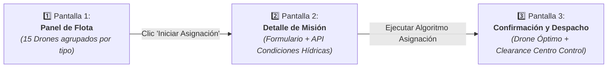

# 🎨 Manual de Identidad Visual, Sistema de Diseño y Guía UX — AquaPort v2 (Prinplup)

Este documento define las directrices formales de diseño, el sistema de componentes con sus estados interactivos, el flujo de tres pantallas para la asignación automática y la fundamentación ergonómica de la **Ley de Fitts** y la **Ley de Hick** para la evolución **AquaPort v2 (Prinplup)**.

> 🌐 **Prototipo Interactivo de Alta Fidelidad:**  
> Se encuentra disponible la maqueta interactiva funcional en: [`docs/aquaport-v2-ux-flota-misiones.html`](file:///docs/aquaport-v2-ux-flota-misiones.html).

---

## 🌊 1. Sistema de Diseño e Identidad Visual (Tokens v2)

### A. Paleta de Colores de Estructura (*Deep Dark Maritime UI*)

| Rol / Token | Código Hex | Variable CSS | Propósito en AquaPort |
|---|---|---|---|
| **Abyssal Navy (Fondo Principal)** | `#070D1F` | `--bg-abyssal` | Fondo general de la plataforma; reduce la fatiga visual en operaciones nocturnas de control. |
| **Ocean Surface (Paneles / Contenedores)** | `#0E172E` | `--bg-surface` | Fondo de módulos, barra de navegación y tarjetas de agrupación. |
| **Deep Card (Tarjetas de Drones)** | `#141F3D` | `--bg-card` | Superficie base de las tarjetas de los 15 drones. |
| **Bioluminescent Cyan (Acento Primario)** | `#38BDF8` | `--cyan-bio` | Acciones principales (CTA), bordes de selección activa y datos de telemetría. |
| **Technical Slate (Bordes y Divisiones)** | `#24355A` | `--border-subtle` | Delimitación sutil entre componentes de datos. |

---

### B. Paleta Semántica de Estados del Drone

| Estado del Drone | Color Hex | Tinte de Fondo (Tint) | Semántica Operacional en el Campus |
|---|---|---|---|
| 🟢 **Disponible** | `#10B981` (Verde Esmeralda) | `rgba(16, 185, 129, 0.12)` | Drone libre para tomar misiones con batería $\ge 35\%$. |
| 🔵 **En Misión** | `#3B82F6` (Azul Océano) | `rgba(59, 130, 246, 0.12)` | Drone en navegación activa ejecutando transporte o muestreo. |
| 🟡 **Recargando** | `#F59E0B` (Ámbar) | `rgba(245, 158, 11, 0.12)` | Drone anclado en estación base recuperando energía. |
| ⚪ **Mantenimiento** | `#64748B` (Gris Pizarra) | `rgba(100, 116, 139, 0.14)` | Fuera de servicio temporal para calibración o reparación física. |
| 🔴 **Fallo Crítico** | `#EF4444` (Rojo Carmesí) | `rgba(239, 68, 68, 0.15)` | Anomalía severa (batería $< 20\%$, pérdida de señal o fallo de propulsión). |
| 🌌 **Sumergido** | `#1E3A8A` (Azul Oscuro / Abismo) | `rgba(30, 58, 138, 0.35)` | Drone Buceador en inmersión activa recolectando muestras de fondo. |

---

### C. Tipografía Oficial

* **Interfaz, Títulos y Botones:** `Inter` / `Outfit` (Sans-serif limpia, geométrica y de máxima legibilidad).
* **Telemetría, IDs Técnicos y Coordenadas:** `JetBrains Mono` (Monoespaciada de alta precisión para evitar desplazamientos al refrescar datos en tiempo real).

---

## 🧩 2. Especificación de Componentes y sus Estados (Reto 08)

### Componente A: Tarjeta de Drone Acuático (6 Estados)

Cada tarjeta representa un drone de la flota y cuenta con una franja de color en su borde superior, una insignia semántica (*badge*), barra de batería con colorimetría reactiva y botón de acción contextual.

1. **Estado 1: Disponible (Verde `#10B981`)**  
   * *Borde superior:* Verde esmeralda sólido.  
   * *Badge:* `● DISPONIBLE` con fondo verde translúcido.  
   * *Acción:* Botón habilitado en estado *Default* («Asignar Misión»).
2. **Estado 2: En Misión (Azul `#3B82F6`)**  
   * *Borde superior:* Azul océano.  
   * *Badge:* `🚢 EN MISIÓN` indicando código de ruta activa (`MIS-042`).  
   * *Acción:* Botón secundario («Ver Telemetría»).
3. **Estado 3: Recargando (Amarillo `#F59E0B`)**  
   * *Borde superior:* Amarillo ámbar.  
   * *Badge:* `⚡ RECARGANDO` con tiempo estimado de carga restante.  
   * *Acción:* Botón deshabilitado («En Estación de Carga»).
4. **Estado 4: Mantenimiento (Gris `#64748B`)**  
   * *Borde superior:* Gris neutro.  
   * *Badge:* `🔧 MANTENIMIENTO` con indicador de técnico asignado.  
   * *Acción:* Botón bloqueado («Fuera de Servicio»).
5. **Estado 5: Fallo (Rojo `#EF4444`)**  
   * *Borde superior:* Rojo pulsante con animación de advertencia.  
   * *Badge:* `🚨 FALLO CRÍTICO` con motivo de alarma y orden técnica emitida.  
   * *Acción:* Botón bloqueado con estilo de alerta roja («Intervención Requerida»).
6. **Estado 6: Sumergido (Azul Oscuro `#1E3A8A`)**  
   * *Borde superior:* Azul abisal profundo.  
   * *Badge:* `🤿 SUMERGIDO` con profundidad de inmersión en metros (ej. `-3.40 m`).  
   * *Acción:* Botón de monitoreo («Monitorear Inmersión»).

---

### Componente B: Botón "Asignar Misión" (5 Estados)

| Estado | Aspecto Visual | Comportamiento e Interacción |
|---|---|---|
| **1. Default** | Fondo degradado cian (`#0284C7` $\rightarrow$ `#38BDF8`), texto oscuro contrastante, sombra sutil. | Listo para recibir el clic del operador. |
| **2. Hover** | Elevación visual (`translateY(-2px)`), resplandor (*glow*) intensificado (`box-shadow`), texto blanco. | Da certeza al operador de que el elemento es interactivo. |
| **3. Procesando (Spinner)** | Fondo cian translúcido, cursor `wait`, icono de spinner animado girando 360°, texto: *"Calculando ruta óptima..."* | Informa que el algoritmo de asignación está ejecutándose (visibilidad del estado del sistema). |
| **4. Éxito** | Fondo verde translúcido con borde `#10B981`, checkmark animado, texto: *"✔ ¡Misión Asignada!"*. | Confirma la reserva exitosa y el clearance del Centro de Control. |
| **5. Deshabilitado** | Opacidad al 40%, cursor `not-allowed`, borde tenue, texto atenuado con candado: *"🔒 Bloqueado (< 35%)"*. | Prevención de errores: impide invocar la acción si el drone no cumple las precondiciones. |

---

### Componente C: Indicador de Batería (3 Umbrales)

| Rango de Batería | Color | Tratamiento Visual | Implicación Operativa |
|---|---|---|---|
| **$\ge 60\%$** | Verde (`#10B981`) | Barra verde con resplandor suave. | **Óptimo:** Apto para cualquier tipo de misión, incluidas emergencias críticas de largo aliento. |
| **$35\% - 59\%$** | Amarillo (`#F59E0B`) | Barra ámbar con advertencia preventiva. | **Moderado:** Apto únicamente para misiones de corta distancia dentro del mismo cuerpo de agua. |
| **$< 35\%$** | Rojo (`#EF4444`) | Barra roja intermitente con mensaje de advertencia: *"⚠ Batería crítica < 35% — Despegue bloqueado"*. | **Crítico:** Despegue denegado por sistema; requiere recarga inmediata obligatoria. |

---

## 🖥️ 3. Flujo Completo de Asignación Automática (3 Pantallas)

### Pantalla 1: Panel de Flota (Monitoreo General)
* **Objetivo:** Ofrecer una vista panorámica instantánea de las 15 unidades de la flota del campus.
* **Componentes:**
  * Cabecera con estado de la API ambiental y **Botón de Parada de Emergencia** en esquina superior derecha.
  * Selector jerárquico de tipo de drone (Superficial, Semisumergido, Buceador) y filtro de estados operativos.
  * Cuadrícula responsive de tarjetas de drones con indicador de batería y acciones contextuales.

### Pantalla 2: Detalle y Configuración de Misión
* **Objetivo:** Parametrizar la orden de servicio antes de que el motor de despacho tome la decisión.
* **Componentes:**
  * Formulario estructurado: Punto de partida, zona de destino, tipo de carga, peso en gramos ($1$ a $1500$g) y nivel de prioridad (`CRITICA`, `ALTA`, `NORMAL`, `BAJA`).
  * Panel lateral en vivo de la **API de Condiciones Hídricas**: Muestra nivel de agitación, profundidad en metros, temperatura y catálogo de drones compatibles.
  * Selector de estrategia de asignación con conmutación inteligente ante prioridad crítica.

### Pantalla 3: Confirmación de Asignación y Despacho
* **Objetivo:** Mostrar el resultado del cálculo del asignador y solicitar la confirmación final de lanzamiento.
* **Componentes:**
  * Tarjeta ampliada del **Drone Óptimo Seleccionado** (ej. `DS-01`), nivel de batería y reserva energética prevista.
  * Badge de autorización formal de ruta emitido por el Centro de Control ECI (*Clearance institucional*).
  * Visualizador esquemático de corredor acuático seguro entre el origen y el destino.
  * Botón de confirmación con estado de éxito y transición al pool de navegación activa.

---

## 🧠 4. Fundamentación Ergonómica: Ley de Fitts y Ley de Hick

### 🛑 A. Ley de Fitts aplicada al Botón de Emergencia

$$\text{Tiempo de Movimiento: } T = a + b \log_2\left(\frac{2D}{W}\right)$$

* **Fundamento Teórico:** El tiempo $T$ requerido para alcanzar un objetivo depende de la distancia $D$ hasta él y del ancho/área $W$ del objetivo. Cuanto mayor sea el área $W$ y más predecible/cercana sea la posición $D$, menor será el tiempo de reacción.
* **Decisión de Diseño en AquaPort:**
  * En una estación de control náutico autónomo, si un dron sufre un fallo hidrográfico o escape de reactivos, el operador debe poder abortar la operación en milisegundos.
  * El **Botón de Parada de Emergencia** se ubica de forma permanente en la **esquina superior derecha fija** del encabezado. Al estar anclado a un borde de pantalla (borde infinito según Fitts), la distancia efectiva $D$ se reduce drásticamente al eliminar el riesgo de pasar de largo con el puntero.
  * Posee dimensiones sobredimensionadas ($W = 185\text{px}$, $H = 44\text{px}$), color rojo carmesí de máximo contraste y sombra brillante pulsante, asegurando un tiempo de acción reflejo sub-segundo ($< 300\text{ ms}$).

---

### 🗂️ B. Ley de Hick aplicada a la Agrupación de los 15 Drones

$$\text{Tiempo de Decisión: } T = b \log_2(n + 1)$$

* **Fundamento Teórico:** El tiempo necesario para tomar una decisión aumenta logarítmicamente con el número de alternativas $n$ no estructuradas que se presentan simultáneamente.
* **Decisión de Diseño en AquaPort:**
  * Presentar los 15 drones en una sola lista plana desordenada ($n = 15$) obligaría al operador a escanear visualmente cada tarjeta, generando saturación cognitiva y demoras operativas.
  * Se aplicó la Ley de Hick subdividiendo la flota en **3 categorías funcionales especializadas**:
    1. 🚤 **Superficial** ($5$ drones): Aguas calmas, carga liviana $\le 500\text{g}$.
    2. 🚢 **Semisumergido** ($5$ drones): Aguas agitadas, corriente fuerte $\le 1.5\text{kg}$.
    3. 🤿 **Buceador** ($5$ drones): Inmersión y toma de sedimentos en profundidad $\le 300\text{g}$.
  * Gracias a esta categorización en pestañas y filtros por zona, el operador reduce su espacio de decisión inmediata a $n = 3$, disminuyendo el tiempo de procesamiento mental en más de un $60\%$.
