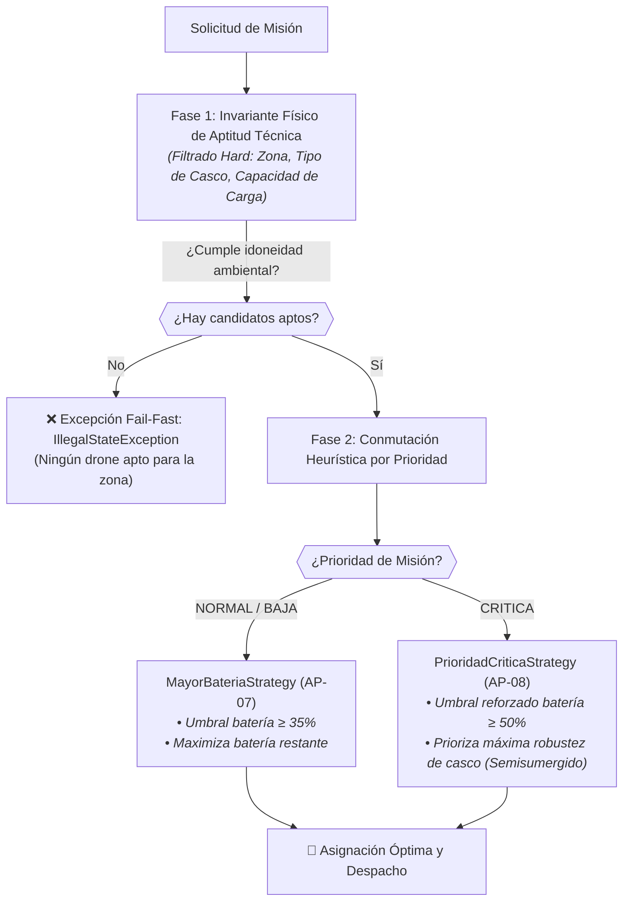

# 📋 Especificación de Requisitos, MoSCoW y Análisis de Tensiones — AquaPort v2 (Prinplup)

Este documento define la especificación formal de los **Requisitos Funcionales (RF)**, **Requisitos No Funcionales (RNF)** con métricas objetivas verificables, la priorización bajo metodología **MoSCoW**, y el análisis y resolución técnica de la tensión entre **AP-07** y **AP-08** para la evolución **AquaPort v2 (Prinplup)**.

---

## 🎯 1. Nuevos Requisitos Funcionales (RF) — AquaPort v2

Formato estricto: **Actor + Acción + Resultado Observable**.

### RF-01: Asignación Autónoma de Drones según Estrategia Activa
* **Actor:** Sistema AquaPort (orquestado por `AsignadorAutomaticoMisiones`) a solicitud del Solicitante/Operador.
* **Acción:** Evalúa la flota completa (15 drones) ante una orden de misión, aplicando de forma autónoma la política configurada (`MayorBateriaStrategy`, `ZonaCercanaStrategy` o `PrioridadCriticaStrategy`) sin intervención humana rutinaria.
* **Resultado Observable:** El sistema selecciona el drone óptimo, reserva su disponibilidad, construye la misión en estado `PENDIENTE` y retorna la asignación con confirmación de ruta en consola/telemetría.
* **Categoría MoSCoW:** **Must Have**
  * *Justificación:* Es la capacidad nuclear que define la evolución a v2 (*autonomía supervisada*).

---

### RF-02: Emisión Multicanal de Alertas de Fallo (Observer)
* **Actor:** Sistema AquaPort / Centro de Control / Técnico de Mantenimiento.
* **Acción:** Detecta en tiempo de ejecución que un drone asignado o en operación entra en estado `FALLO` o cae a batería crítica ($< 20\%$).
* **Resultado Observable:** El sistema dispara el evento síncrono a todos los observadores registrados (`ObservadorFalloDrone`), generando una alerta severa en el `CentroControlObserver` y despachando una orden de revisión prioritaria con diagnóstico al `TecnicoMantenimientoObserver`.
* **Categoría MoSCoW:** **Must Have**
  * *Justificación:* La seguridad física de la flota y la mitigación de pérdida de equipos en cuerpos de agua depende de la notificación inmediata a las cuadrillas de rescate.

---

### RF-03: Filtrado y Adaptación por Condiciones Hídricas
* **Actor:** Sistema AquaPort (consumiendo la *API de Condiciones Hídricas*).
* **Acción:** Consulta el estado limnológico de la zona hídrica de destino (`CALMA`, `AGITADA`, `PROFUNDA`, nivel de turbulencia y profundidad en metros) antes de autorizar la misión.
* **Resultado Observable:** El motor de asignación descarta los drones físicamente incompatibles (ej. excluye `DroneSuperficial` en aguas agitadas o de profundidad $> 1\text{m}$) y filtra exclusivamente los modelos con casco y propulsión aptos (`DroneSemisumergido` o `DroneBuceador`).
* **Categoría MoSCoW:** **Must Have**
  * *Justificación:* Evita el hundimiento o volcamiento de drones superficiales en zonas de fuerte oleaje o corrientes.

---

### RF-04: Gestión de Órdenes de Servicio y Reintegración por Técnico
* **Actor:** Técnico de Mantenimiento.
* **Acción:** Consulta en el panel las unidades en estado `FALLO` o `MANTENIMIENTO`, inspecciona el diagnóstico preliminar emitido por el sistema, repara la unidad física e ingresa el reporte de conformidad.
* **Resultado Observable:** El sistema transiciona el estado del drone intervenido a `DISPONIBLE`, restableciendo su elegibilidad para ser tomado en cuenta en la próxima asignación autónoma.
* **Categoría MoSCoW:** **Should Have**
  * *Justificación:* Vital para la sustentabilidad de la flota en el mediano plazo, aunque durante las primeras horas de un incidente las asignaciones pueden continuar con las unidades remanentes.

---

## ⚙️ 2. Requisitos No Funcionales (RNF) con Métrica Objetiva

> [!NOTE]
> Todos los RNF cumplen con la regla de oro de la ingeniería de software: **Métrica cuantitativa, contexto de carga y método/instrumento de verificación reproducible**. Se prohíben declaraciones ambiguas como *"el sistema debe ser rápido"*.

---

### RNF-01: Rendimiento del Algoritmo de Asignación Automática
* **Descripción:** El algoritmo de selección y asignación automática debe determinar y reservar el drone óptimo en un tiempo imperceptible para el solicitante bajo condiciones de carga de flota completa.
* **Métrica concreta:** Latencia máxima de selección $\le 400\text{ ms}$ para una flota de hasta **30 drones** en memoria (percentil 99).
* **Método de verificación:** Prueba unitaria automatizada en JUnit 5 utilizando `assertTimeout(Duration.ofMillis(400), () -> asignador.seleccionarDroneOptimo(...))`.
* **Categoría MoSCoW:** **Must Have**
  * *Justificación:* En emergencias ambientales, el tiempo de cálculo no puede retrasar el despliegue del dron de contención.

---

### RNF-02: Latencia de Despacho de Eventos Críticos (Observer Pattern)
* **Descripción:** La propagación de alertas ante un drone en estado `FALLO` debe ser inmediata a través de la lista de observadores suscritos.
* **Métrica concreta:** Tiempo de notificación total a todos los observadores registrados $\le 50\text{ ms}$ y tasa de entrega del $100\%$ (cero eventos perdidos o ignorados).
* **Método de verificación:** Prueba de integración con Mockito y JUnit 5 verificando `verify(observador, times(1)).notificarFallo(...)` y cronometrado con `System.nanoTime()`.
* **Categoría MoSCoW:** **Must Have**
  * *Justificación:* Si la alarma no se emite en milisegundos, el operador y el técnico pierden la ventana de recuperación del dron antes de que se hunda o sea arrastrado.

---

### RNF-03: Robustez e Invariantes de Seguridad Física (*Fail-Fast*)
* **Descripción:** El validador y el asignador deben impedir de manera determinística cualquier misión con batería inferior al límite operativo o con sobrepeso de carga útil.
* **Métrica concreta:** Cero ($0$) asignaciones permitidas a drones con batería $< 35\%$ en misiones estándar ($< 50\%$ en críticas) o peso superior a la capacidad del modelo (0.50kg, 1.50kg, 0.30kg), rechazando el intento en menos de **10 ms** mediante `IllegalStateException`.
* **Método de verificación:** Suite de pruebas negativas de JUnit 5 (`assertThrows(IllegalStateException.class, ...)`).
* **Categoría MoSCoW:** **Must Have**
  * *Justificación:* Un fallo en esta validación causaría que el dron se descargue en medio del embalse, perdiendo la instrumentación científica.

---

### RNF-04: Extensibilidad Arquitectónica y Acoplamiento (Open/Closed Principle)
* **Descripción:** El núcleo de asignación debe permitir la adición de nuevos modelos de drones o nuevas políticas heurísticas sin requerir modificaciones en su código fuente.
* **Métrica concreta:** Cero ($0$) líneas modificadas en `AsignadorAutomaticoMisiones.java` al incorporar un 4to tipo de drone (`DroneSumergibleProfundo`) o una nueva estrategia de selección (`PrimerDisponibleStrategy`), verificado con `git diff`.
* **Método de verificación:** Prueba de regresión arquitectónica en `SolidPrincipiosTest.java` compilando y ejecutando satisfactoriamente con clases externas.
* **Categoría MoSCoW:** **Should Have**
  * *Justificación:* Protege la estabilidad del código base a medida que la ECI adquiera drones de nuevos fabricantes o proveedores.

---

## 📊 3. Matriz Resumen de Priorización MoSCoW

| ID | Tipo | Descripción Sintética | Prioridad MoSCoW | Justificación en una sola oración |
|---|---|---|---|---|
| **RF-01** | Funcional | Asignación automática de drones por Strategy | **Must Have** | Es el núcleo funcional de la autonomía v2 que reemplaza la asignación manual humana. |
| **RF-02** | Funcional | Alertas síncronas de fallo a Centro de Control y Técnico | **Must Have** | Garantiza la respuesta inmediata ante emergencias de navegación y salvamento de equipos. |
| **RF-03** | Funcional | Filtrado hidrológico por tipo de agua (Calma/Agitada/Profunda) | **Must Have** | Evita la asignación de drones vulnerables en zonas donde las corrientes provocarían volcamientos. |
| **RF-04** | Funcional | Gestión de órdenes técnicas y retorno a estado `DISPONIBLE` | **Should Have** | Permite reincorporar unidades al ciclo operativo tras reparaciones de taller. |
| **RNF-01** | No Funcional | Latencia de asignación $\le 400\text{ ms}$ para 30 drones | **Must Have** | Asegura decisiones en tiempo real sin bloquear la interfaz ni los protocolos de despacho. |
| **RNF-02** | No Funcional | Despacho de alertas a observadores $\le 50\text{ ms}$ | **Must Have** | Esencial para que el técnico reciba el aviso de contingencia antes de la pérdida de la unidad. |
| **RNF-03** | No Funcional | 100% rechazo *fail-fast* de batería crítica o sobrepeso en $\le 10\text{ ms}$ | **Must Have** | Protege los drones contra agotamiento energético o hundimiento por exceso de carga. |
| **RNF-04** | No Funcional | Cero modificaciones en el Asignador al agregar tipos/estrategias (OCP) | **Should Have** | Reduce costos de mantenimiento y riesgo de regresiones ante el crecimiento de la flota. |

### 🚫 Fuera de Alcance v2 (*Could Have* / *Won't Have*)
* **Could Have:** Reprogramación dinámica de rutas en pleno vuelo ante cambios repentinos de viento o marea.
* **Won't Have (v2):** Enjambres colaborativos coordinados entre múltiples drones y recarga inductiva solar autónoma (reservado para v3 / Empoleon).

---

## ⚡ 4. Detección y Resolución de la Tensión: AP-07 vs. AP-08

### 🔍 Planteamiento de la Tensión

En los requerimientos de la v2 coexisten dos postulados operacionales:

* **AP-07:** *«El sistema asigna automáticamente el drone de mayor batería disponible para cualquier misión hídrica.»*
* **AP-08:** *«Las misiones CRÍTICAS tienen prioridad absoluta: deben recibir el drone técnicamente más apto para la zona, independientemente de la batería.»*

```
┌────────────────────────────────────────────────────────────────────────────────────────┐
│                               ¿POR QUÉ NO SON CONTRADICTORIOS?                         │
│ Ambos requisitos persiguen la resiliencia del sistema, pero operan bajo premisas de   │
│ optimización distintas: AP-07 busca longevidad y balanceo de desgaste en misiones      │
│ rutinarias; AP-08 busca eficacia estricta y supervivencia ante contingencias graves.   │
├────────────────────────────────────────────────────────────────────────────────────────┤
│                                ¿DÓNDE NACE LA TENSIÓN?                                 │
│ Si una misión es CRÍTICA en un canal agitado, y la flota tiene:                        │
│   • DroneSuperficial con 98% de batería (batería máxima, pero NO apto para agitación)  │
│   • DroneSemisumergido con 65% de batería (perfectamente apto para agitación)          │
│ • Siguiendo ciegamente AP-07: Se asignaría el DroneSuperficial (¡zozobraría!).         │
│ • Siguiendo ciegamente AP-08 sin límite: Si el Semisumergido tuviera 5% de batería,    │
│   se le enviaría solo por ser "el más apto", apagándose en el agua (¡pérdida total!).   │
└────────────────────────────────────────────────────────────────────────────────────────┘
```

### 🛠️ Solución Arquitectónica en AquaPort v2

La tensión se resuelve formalmente mediante una **tubería de evaluación de 3 etapas desacopladas** combinada con el **Patrón Strategy**:



#### Reglas de Decisión Implementadas:
1. **La Aptitud Técnica es un Invariante No Negociable:**  
   Ningún drone participa en la selección si no soporta las condiciones hídricas de la zona (`condicionAgua.esCompatibleCon(d.getTipo())`) o si su capacidad de carga es inferior al peso de la muestra (`d.getCapacidadCargaKg() >= peso`).
2. **Umbral Mínimo de Batería Diferenciado:**  
   * Misión Normal: Requiere $\ge 35\%$ de batería.
   * Misión Crítica: Requiere $\ge 50\%$ de batería (`PrioridadCriticaStrategy.BATERIA_MINIMA_CRITICA`). Jamás se despacha un drone "técnicamente apto" si su nivel de carga compromete el retorno a base.
3. **Selección Polimórfica (Zero `instanceof`):**  
   El `AsignadorAutomaticoMisiones` delega el desempate a la estrategia inyectada. Ante misiones críticas, la estrategia favorece el tipo de mayor robustez (`SEMISUMERGIDO`) garantizando cumplimiento simultáneo de **AP-08** y resguardo energético de **AP-07**.
