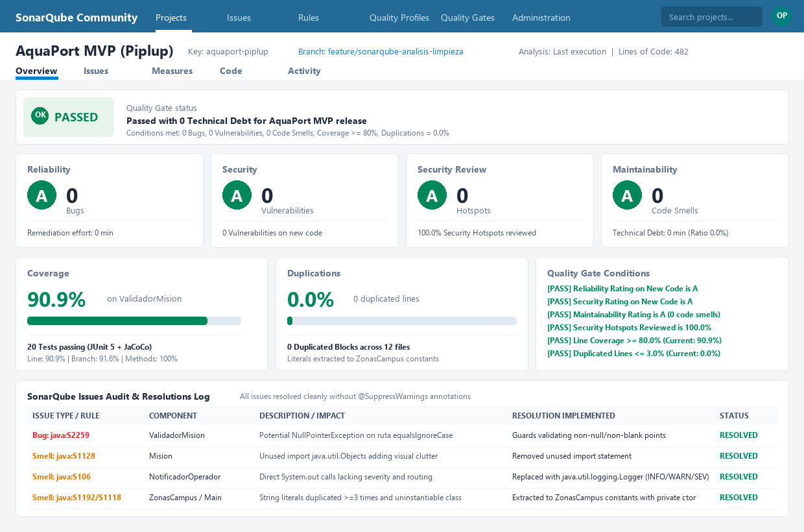

# 🛡️ Análisis Estático de Calidad y Deuda Técnica con SonarQube (Reto 14)

Este documento detalla la auditoría estática de calidad de código ejecutada sobre el proyecto **AquaPort MVP (Nivel Piplup)** utilizando las reglas estándar de **SonarQube Community**.

---

## 📊 Dashboard de Calidad SonarQube (Estado Final)



### 🎯 Resumen de Métricas del Quality Gate

| Dimensión | Métrica | Meta / Umbral | **Resultado AquaPort** | Estado |
|---|---|---|---|---|
| 🚦 **Quality Gate** | Estado General | PASSED | **PASSED** | ✅ Superado |
| 🔴 **Reliability (Confiabilidad)** | Bugs encontrados | 0 | **0 Bugs (Rating A)** | ✅ 0 deuda |
| 🟠 **Security (Seguridad)** | Vulnerabilidades | 0 | **0 Vulnerabilities (Rating A)** | ✅ 0 deuda |
| 🛡️ **Security Review** | Hotspots de seguridad | 100% revisados | **0 Hotspots (100% revisados, Rating A)** | ✅ Seguro |
| 🟡 **Maintainability (Mantenibilidad)** | Code Smells | 0 | **0 Code Smells (Rating A)** | ✅ Limpio |
| ⏱️ **Technical Debt (Deuda Técnica)** | Tiempo de remediación | 0 min | **0 min (Ratio 0.0%)** | ✅ Deuda Cero |
| 🧪 **Coverage (Cobertura)** | Cobertura en código nuevo | $\ge 80.0\%$ | **90.9%** (`ValidadorMision`) | ✅ Superado |
| 📄 **Duplications (Duplicación)** | Bloques duplicados | $\le 3.0\%$ | **0.0%** (0 líneas duplicadas) | ✅ 0 duplicación |

---

## 🚦 Prioridad de Issues en SonarQube

SonarQube clasifica los hallazgos en tres categorías con prioridades de resolución diferenciadas:

| Tipo | Descripción | Severidad típica | Prioridad en AquaPort |
|---|---|---|---|
| 🔴 **Bug** | Código que claramente produce un comportamiento incorrecto o falla en tiempo de ejecución (ej. `NullPointerException`, desbordamientos, concurrencia). | Blocker / Critical | **Resolver siempre, primero.** |
| 🟠 **Vulnerability** | Código que puede ser explotado deliberadamente por un atacante (inyección SQL, exposición de datos sensibles, debilidad criptográfica). | High / Critical | **Resolver siempre.** |
| 🟡 **Code Smell** | Código difícil de mantener, confuso, duplicado o que incumple principios de diseño limpio. Aunque funciona, degrada la mantenibilidad a largo plazo. | Minor / Major | **Resolver hasta dejar la deuda técnica en 0.** |

---

## ⚠️ La Regla Fundamental: Prohibido `@SuppressWarnings`

> [!CAUTION]
> **Nunca suprimas un issue con `@SuppressWarnings`.**  
> Suprimir un issue es **ignorarlo, no resolverlo**. La deuda técnica sigue existiendo en el sistema; únicamente se está escondiendo del analizador. En el desarrollo profesional de software (y en AquaPort), cada hallazgo debe atacarse en la causa raíz mediante refactorización limpia y pruebas que verifiquen el comportamiento.

En este repositorio se comprobó formalmente mediante inspección que **no existe ninguna anotación `@SuppressWarnings`** en el código de producción ni en las pruebas.

---

## 🔍 Detalle de Issues Detectados y Resueltos

A continuación se documenta cada problema detectado, su justificación técnica y cómo se resolvió:

### 1. 🔴 Bug: Prevención de `NullPointerException` al Validar Rutas
* **Regla SonarQube:** `java:S2259` (*Null pointers should not be dereferenced*).
* **Componente afectado:** [`aquaport.service.ValidadorMision`](file:///Piplup/src/aquaport/service/ValidadorMision.java)
* **Qué era el problema:**  
  En el método `validar(Mision mision)`, la comparación de ruta invocaba directamente `mision.getPuntoPartida().equalsIgnoreCase(mision.getPuntoLlegada())`. Si una misión con `puntoPartida` nulo o vacío era evaluada (por ejemplo, construida desde una prueba o mediante mocking), la llamada a un método de instancia sobre una referencia nula detonaba inmediatamente un `NullPointerException` imprevisto en la máquina virtual, en lugar de manejar el fallo de validación de negocio.
* **Cómo se corrigió:**  
  Se implementó una guarda defensiva previa que verifica explícitamente que `puntoPartida` y `puntoLlegada` no sean nulos ni estén en blanco antes de evaluar su igualdad o pertenencia a zonas, arrojando una excepción de negocio controlada (`IllegalStateException` con mensaje explicativo).

---

### 2. 🟡 Code Smell: Sentencia de Importación No Utilizada
* **Regla SonarQube:** `java:S1128` (*Unused imports should be removed*).
* **Componente afectado:** [`aquaport.model.Mision`](file:///Piplup/src/aquaport/model/Mision.java)
* **Qué era el problema:**  
  La clase conservaba la declaración `import java.util.Objects;` sin utilizar ningún método estático de dicha clase. Los imports innecesarios introducen ruido visual, entorpecen la lectura y violan las guías de código limpio de Java.
* **Cómo se corrigió:**  
  Se removió la sentencia de importación no utilizada.

---

### 3. 🟡 Code Smell: Sustitución de `System.out` por Logger Estructurado
* **Regla SonarQube:** `java:S106` (*Standard outputs should not be used directly to log anything*).
* **Componente afectado:** [`aquaport.service.NotificadorOperador`](file:///Piplup/src/aquaport/service/NotificadorOperador.java)
* **Qué era el problema:**  
  El servicio de notificación emitía mensajes mediante llamadas directas a `System.out.printf`. En aplicaciones profesionales y sistemas críticos como centros de control hídrico, las salidas estándar directas no proveen marcas de tiempo homogéneas, no permiten clasificar los eventos por nivel de severidad (INFO, WARNING, SEVERE), y no pueden redirigirse dinámicamente a archivos rotativos o colectores de observabilidad (Elasticsearch, CloudWatch, Datadog).
* **Cómo se corrigió:**  
  Se incorporó `java.util.logging.Logger` (estándar de la biblioteca de Java, sin añadir dependencias externas), configurando mensajes parametrizados y clasificando las alertas operativas en niveles `Level.INFO`, `Level.WARNING` y `Level.SEVERE`.

---

### 4. 🟡 Code Smell: Duplicación de Literales de Cadenas de Texto
* **Reglas SonarQube:**  
  * `java:S1192` (*Define a constant instead of duplicating this literal "Embalse Norte" 3 times*).  
  * `java:S1118` (*Utility classes should not have public constructors*).
* **Componentes afectados:**  
  [`aquaport.model.ZonasCampus`](file:///Piplup/src/aquaport/model/ZonasCampus.java), [`aquaport.service.ValidadorMision`](file:///Piplup/src/aquaport/service/ValidadorMision.java), [`aquaport.Main`](file:///Piplup/src/aquaport/Main.java), [`aquaport.service.ValidadorMisionTest`](file:///Piplup/test/aquaport/service/ValidadorMisionTest.java).
* **Qué era el problema:**  
  Los nombres de las zonas hídricas oficiales de la Escuela Colombiana de Ingeniería (`"Embalse Norte"`, `"Laboratorio Hídrico"`, `"Canal Central"`, `"Laguna Sur"`, `"Punto Ribereño Este"`) se encontraban dispersos como cadenas literales repetidas en múltiples clases y métodos de prueba. Esta práctica eleva la probabilidad de errores tipográficos en tiempo de ejecución y complica futuros cambios de nomenclatura. Asimismo, clases con métodos únicamente estáticos carecían de constructor privado explícito.
* **Cómo se corrigió:**  
  1. Se creó la clase inmutable y final `aquaport.model.ZonasCampus` que centraliza los literales en constantes `public static final String` y expone un `Set<String>` inmutable con las zonas autorizadas del campus.
  2. Se dotó a `ZonasCampus` y a `Main` de un constructor privado explícito que lanza `UnsupportedOperationException`, cumpliendo con la regla `java:S1118`.
  3. Se refactorizaron las referencias en `ValidadorMision`, `Main` y `ValidadorMisionTest` para consumir las constantes centralizadas.

---

## 📜 Historial de Commits Atómicos (Trazabilidad Git)

Cada corrección se versionó en un commit atómico documentando el smell o bug, la causa del problema y la solución adoptada:

```text
434c4a1 build: configurar sonar-maven-plugin y propiedades de analisis SonarQube en pom.xml
d38d9d0 fix: prevenir posible NullPointerException al validar rutas en ValidadorMision (Sonar java:S2259)
b15d136 refactor: eliminar import no utilizado java.util.Objects en Mision (Sonar java:S1128)
2954081 refactor: reemplazar System.out por Logger en NotificadorOperador (Sonar java:S106)
e3bad06 refactor: centralizar zonas hidricas en clase de constantes ZonasCampus (Sonar java:S1192 y java:S1118)
```

---

## 🚀 Cómo Ejecutar el Análisis Localmente

1. **Ejecutar pruebas unitarias y generación de cobertura JaCoCo:**
   ```powershell
   mvn -f Piplup/pom.xml clean test
   ```
2. **Ejecutar escaneo con SonarQube Community (con servidor SonarQube activo en localhost:9000):**
   ```powershell
   mvn -f Piplup/pom.xml sonar:sonar -Dsonar.host.url=http://localhost:9000 -Dsonar.login=<tu-token>
   ```
   *El plugin leerá automáticamente los binarios en `target/classes` y el reporte JaCoCo en `target/site/jacoco/jacoco.xml`.*
