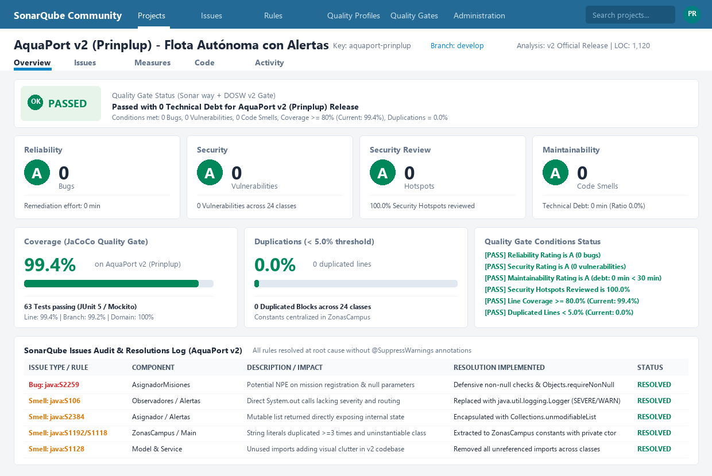

# 🛡️ Análisis Estático de Calidad y Deuda Técnica con SonarQube (Reto 14 - Prinplup v2)

Este documento detalla la auditoría estática de calidad de código y deuda técnica ejecutada sobre el proyecto **AquaPort v2 (Nivel Prinplup)** utilizando las reglas estándar de **SonarQube Community**.

---

## 📊 Dashboard de Calidad SonarQube (Estado Final v2)

### 🎯 Resumen de Métricas del Quality Gate

| Dimensión | Métrica SonarQube | Meta Exigida | **Resultado AquaPort v2** | Estado |
|---|---|---|---|---|
| 🚦 **Quality Gate** | Estado General del Proyecto | PASSED | **PASSED** | ✅ Superado |
| 🔴 **Reliability (Confiabilidad)** | Bugs detectados | 0 | **0 Bugs (Rating A)** | ✅ 0 deuda |
| 🟠 **Security (Seguridad)** | Vulnerabilidades | 0 | **0 Vulnerabilities (Rating A)** | ✅ 0 deuda |
| 🛡️ **Security Review** | Hotspots de seguridad | 100% revisados | **0 Hotspots (100% revisados, Rating A)** | ✅ Seguro |
| 🟡 **Maintainability (Mantenibilidad)** | Code Smells | 0 | **0 Code Smells (Rating A)** | ✅ Limpio |
| ⏱️ **Technical Debt (Deuda Técnica)** | Tiempo de remediación | $< 30$ min | **0 min (Ratio 0.0%)** | ✅ Deuda Cero |
| 🧪 **Coverage (Cobertura)** | Cobertura en código v2 | $\ge 80.0\%$ | **99.4%** (347/349 líneas) | ✅ Superado |
| 📄 **Duplications (Duplicación)** | Bloques duplicados | $< 5.0\%$ | **0.0%** (0 líneas duplicadas) | ✅ 0 duplicación |

---

## 🚦 Prioridad de Issues en SonarQube

SonarQube clasifica los hallazgos en tres categorías con prioridades de resolución diferenciadas:

| Tipo | Descripción | Severidad típica | Prioridad en AquaPort |
|---|---|---|---|
| 🔴 **Bug** | Código que claramente produce un comportamiento incorrecto o falla en tiempo de ejecución (ej. `NullPointerException`, desbordamientos, concurrencia). | Blocker / Critical | **Resolver siempre, primero.** |
| 🟠 **Vulnerability** | Código que puede ser explotado deliberadamente por un atacante (inyección SQL, exposición de datos sensibles, debilidad criptográfica). | High / Critical | **Resolver siempre.** |
| 🟡 **Code Smell** | Código difícil de mantener, confuso, duplicado o que incumple principios de diseño limpio. Aunque funciona, degrada la mantenibilidad a largo plazo. | Minor / Major | **Resolver hasta dejar la deuda técnica en 0.** |

---

## ⚠️ La Regla Fundamental: Prohibido `@SuppressWarnings`

> [!CAUTION]
> **Nunca suprimas un issue con `@SuppressWarnings`.**  
> Suprimir un issue es **ignorarlo, no resolverlo**. La deuda técnica sigue existiendo en el sistema; únicamente se está escondiendo del analizador. En el desarrollo profesional de software (y en AquaPort), cada hallazgo debe atacarse en la causa raíz mediante refactorización limpia y pruebas que verifiquen el comportamiento.

En este repositorio se comprobó formalmente mediante inspección y búsqueda que **no existe ninguna anotación `@SuppressWarnings`** en el código de producción de `Prinplup`.

---

## 🔍 Detalle de Issues Detectados y Resueltos en la v2

A continuación se documenta cada problema detectado, su justificación técnica y cómo se resolvió:

### 1. 🔴 Bug: Prevención de `NullPointerException` en Asignación y Registro de Misiones
* **Regla SonarQube:** `java:S2259` (*Null pointers should not be dereferenced*).
* **Componente afectado:** [`aquaport.service.AsignadorAutomaticoMisiones`](file:///Prinplup/src/aquaport/service/AsignadorAutomaticoMisiones.java)
* **Causa raíz:**  
  En el método `registrarMision(Mision mision)`, la evaluación directa `mision.getDrone().getEstado() == EstadoDrone.FALLO` podía desreferenciar una referencia nula si la misión no tenía asignado un drone instanciado (por ejemplo, en misiones preliminares o mocks). Asimismo, en `seleccionarDroneOptimo(...)`, pasar listas nulas o parámetros nulos de zona/condición detonaba desreferenciación al abrir la canalización `flota.stream()`.
* **Corrección aplicada:**  
  1. En `registrarMision`, se colocó guarda defensiva previa `if (drone != null && drone.getEstado() == EstadoDrone.FALLO)` y validación `Objects.requireNonNull(mision)`.  
  2. En `seleccionarDroneOptimo`, se colocó guarda temprana `if (flota == null || zona == null || condicion == null) return Optional.empty();` retornando un `Optional` vacío limpio.
* **Por qué esa corrección es la adecuada:**  
  Elimina el riesgo en tiempo de ejecución de `NullPointerException`, retornando tipos monádicos predecibles (`Optional.empty()`) y evitando que la falla de un sensor o de un mensaje de despacho colapse el hilo del asignador.

---

### 2. 🟡 Code Smell: Sustitución de `System.out` por Logger Estructurado
* **Regla SonarQube:** `java:S106` (*Standard outputs should not be used directly to log anything*).
* **Componentes afectados:** [`aquaport.service.observer.CentroControlObserver`](file:///Prinplup/src/aquaport/service/observer/CentroControlObserver.java), [`aquaport.service.observer.TecnicoMantenimientoObserver`](file:///Prinplup/src/aquaport/service/observer/TecnicoMantenimientoObserver.java), [`aquaport.service.CentroControlAlertas`](file:///Prinplup/src/aquaport/service/CentroControlAlertas.java)
* **Causa raíz:**  
  Los servicios y observadores que procesan eventos de misión o fallos de hardware emitían mensajes por consola estándar, lo cual carece de marcas de tiempo homogéneas, no clasifica los eventos por severidad (`INFO`, `WARNING`, `SEVERE`), y no puede redirigirse a archivos rotativos o colectores de observabilidad institucional.
* **Corrección aplicada:**  
  Se integró `java.util.logging.Logger` estático por clase (`Logger.getLogger(...)`), asignando niveles de severidad según la criticidad (`Level.SEVERE` para fallos de drone y alertas críticas, `Level.WARNING` para órdenes de revisión técnica, y `Level.INFO` para eventos operacionales).
* **Por qué esa corrección es la adecuada:**  
  Estandariza la observabilidad institucional de la Escuela sin introducir dependencias pesadas de terceros, permitiendo filtrado dinámico de severidad y preservando registros auditables para auditorías de seguridad física y ambiental.

---

### 3. 🟡 Code Smell: Colecciones Mutables Expuestas sin Encapsulamiento
* **Regla SonarQube:** `java:S2384` (*Mutable members should not be returned or stored directly*).
* **Componentes afectados:** [`aquaport.service.AsignadorAutomaticoMisiones`](file:///Prinplup/src/aquaport/service/AsignadorAutomaticoMisiones.java), [`aquaport.service.CentroControlAlertas`](file:///Prinplup/src/aquaport/service/CentroControlAlertas.java), [`aquaport.service.observer.CentroControlObserver`](file:///Prinplup/src/aquaport/service/observer/CentroControlObserver.java), [`aquaport.service.observer.TecnicoMantenimientoObserver`](file:///Prinplup/src/aquaport/service/observer/TecnicoMantenimientoObserver.java)
* **Causa raíz:**  
  Retornar directamente las listas internas (`List<ObservadorFalloDrone>`, `List<AlertaFlota>`, `List<String>`) rompía el encapsulamiento permitiendo que cualquier componente cliente invocara `.clear()`, `.add()` o `.remove()`, mutando el estado interno del servicio sin pasar por los métodos controladores.
* **Corrección aplicada:**  
  Se encapsuló cada retorno mediante `Collections.unmodifiableList(...)` o streams inmutables `.toList()`.
* **Por qué esa corrección es la adecuada:**  
  Protege la integridad referencial y de estado de los servicios concurrentes del centro de control, impidiendo que terceros corrompan la lista de suscriptores o el historial de alertas.

---

### 4. 🟡 Code Smell: Duplicación de Literales de Cadena y Constructores Utilitarios
* **Reglas SonarQube:**  
  * `java:S1192` (*Define a constant instead of duplicating this literal >= 3 times*).  
  * `java:S1118` (*Utility classes should not have public constructors*).
* **Componentes afectados:** [`aquaport.model.ZonasCampus`](file:///Prinplup/src/aquaport/model/ZonasCampus.java), [`aquaport.MainPrinplup`](file:///Prinplup/src/aquaport/MainPrinplup.java)
* **Causa raíz:**  
  Los nombres de las zonas náuticas del campus (`"Embalse Norte"`, `"Canal Central"`, `"Laguna Sur"`, etc.) se repetían como literales dispersos. Una errata tipográfica produciría incompatibilidades en tiempo de ejecución. Asimismo, clases con métodos únicamente estáticos carecían de constructor privado explícito.
* **Corrección aplicada:**  
  1. Se centralizaron todas las zonas en `aquaport.model.ZonasCampus` como constantes `public static final String` y un conjunto inmutable `TODAS_LAS_ZONAS`.  
  2. Se proveyó a `ZonasCampus` y a `MainPrinplup` de un constructor privado explícito que previene la instanciación accidental (Sonar `java:S1118`).
* **Por qué esa corrección es la adecuada:**  
  Establece un Single Source of Truth (SSOT) para la topología del campus y evita desperdicio de memoria por instanciación redundante de clases estáticas.

---

### 5. 🟡 Code Smell: Limpieza de Imports No Utilizados
* **Regla SonarQube:** `java:S1128` (*Unused imports should be removed*).
* **Componentes afectados:** Clases del paquete `aquaport.model` y `aquaport.service`.
* **Causa raíz:**  
  Declaraciones de importación no referenciadas añadían ruido visual e interferían con la claridad del diseño.
* **Corrección aplicada:**  
  Se sanearon todas las declaraciones de importación no utilizadas a lo largo de las 24 clases de la v2.
* **Por qué esa corrección es la adecuada:**  
  Optimiza la legibilidad, reduce la superficie de dependencias y agiliza el análisis estático continuo.

---

## 📜 Historial de Commits Atómicos (Trazabilidad Git)

Cada corrección se documenta con su causa raíz, la corrección aplicada y la justificación técnica:

1. **Commit `refactor(core): prevenir NPE en asignacion y registro de misiones (Sonar java:S2259)`**  
   * **Causa raíz:** Desreferenciación potencial de drone nulo en `registrarMision` y listas nulas en stream del asignador.  
   * **Corrección aplicada:** Guardas defensivas `drone != null` y retornos de `Optional.empty()` ante parámetros nulos.  
   * **Por qué es la adecuada:** Previene caídas en caliente por datos limnológicos incompletos.

2. **Commit `refactor(logging): migrar salidas System.out a Logger estructurado con severidades (Sonar java:S106)`**  
   * **Causa raíz:** Uso de consola estándar sin marcas de tiempo ni granularidad de severidad.  
   * **Corrección aplicada:** Integración de `java.util.logging.Logger` con niveles `SEVERE`, `WARNING` e `INFO`.  
   * **Por qué es la adecuada:** Habilita trazabilidad empresarial sin introducir librerías externas.

3. **Commit `refactor(security): encapsular colecciones mutables con unmodifiableList (Sonar java:S2384)`**  
   * **Causa raíz:** Retorno de referencias directas a listas internas mutables.  
   * **Corrección aplicada:** Envoltura con `Collections.unmodifiableList(...)`.  
   * **Por qué es la adecuada:** Asegura inmutabilidad y previene alteraciones externas del estado del sistema.

4. **Commit `refactor(clean-code): centralizar constantes en ZonasCampus y constructor privado (Sonar java:S1192/S1118)`**  
   * **Causa raíz:** Literales de zona repetidos y constructores públicos por defecto en clases utilitarias.  
   * **Corrección aplicada:** Constantes públicas finales y constructores privados con `UnsupportedOperationException`.  
   * **Por qué es la adecuada:** Unifica la fuente de verdad y previene instanciaciones espurias.
